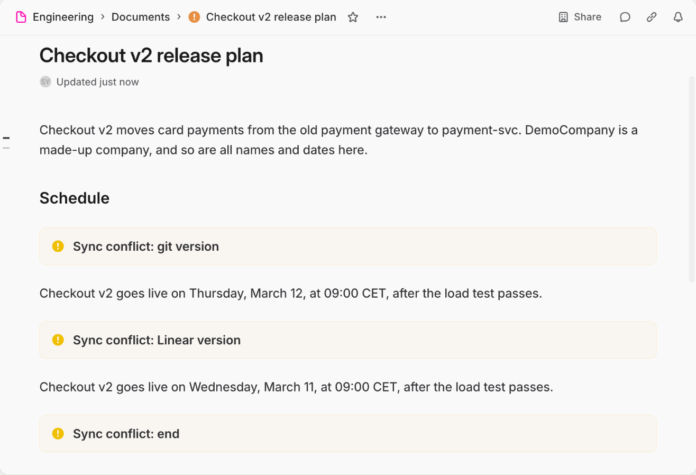

<picture>
  <source media="(prefers-color-scheme: dark)" srcset="docs/images/hero-dark.svg">
  
</picture>

Two-way sync between Linear documents and Markdown in your repository. It runs
as a GitHub Action under apps you create: no server we own, no key we hold.

## Why

**One knowledge base, readable by people and agents.**

- **One to one with your agent, in files.** Specs, plans and documents live as
  Markdown in your repository, where you and the agent read and write them
  together.
- **With your team, in Linear.** The same documents stay in sync in Linear,
  where anyone can edit, discuss and comment on them without git.

## Why it is safe

- **Inside your perimeter.** The sync runs in your GitHub Actions runner,
  under a Linear OAuth app and a GitHub App that you create. Nothing runs on
  our server and we hold no key.
- **Short-lived tokens.** Each run gets its own Linear token and revokes it at
  the end. No personal API key.
- **Quality gates before any push.** Changes from Linear pass your
  repository's security and privacy quality gates. Your pre-commit hooks
  marked with `alias: security` run on every change first, and if one fails,
  nothing is pushed to git. A rejected change gets a red mark in Linear.
- **The same checks as everyone else.** Changes from Linear reach `main`
  through a sync pull request, with the same checks as the pull requests of
  people and agents.
- **Every release reviewed by frontier models.** Each release is reviewed for
  vulnerabilities by two frontier language models, and its security report is
  published with the release (see [Security](#security)).

## How it works

There is no mdbisync service and no database. Each run is a job in your
GitHub Actions runner. The sync's state lives in three refs of your
repository under `refs/mdbisync/`, outside your branches and files. From
them the sync opens its pull requests to `main`.

Two workflows do the work:

- **Initial sync**, run once by hand, in one direction: it makes Linear
  equal to `main`, or opens a pull request that makes `main` equal to Linear.
- **Sync**, run on every push to `main` and on a schedule, keeps both sides
  equal from then on. GitHub's schedule can be late, so for timely runs start
  it from your own timer (see [Scheduler](#scheduler)).

## Conflicts

**A true three-way merge.** Edits from git and from Linear are merged against
the version both sides last agreed on, so changes to different paragraphs
simply combine. When both sides change the same paragraph, the document keeps
both versions and is marked orange in Linear until someone resolves the
conflict.

To resolve it, keep the text you want and remove the conflict markers, in
Linear or in git. See details in [docs/conflicts.md](docs/conflicts.md).

## Features

- **Both directions:** edits, new documents, renames, moves and deletes
  travel each way.
- **Folders as teams and projects:** the front matter of a folder's `README.md`
  maps it to a Linear team and project; deeper folders become title paths.
- **Images and files:** files a document links are uploaded to Linear once;
  supported images and documents pasted in Linear land in an `assets/` folder
  beside the document (`assets/<sha256>.png`), one per folder, in Git LFS
  when your `.gitattributes` says so (`mdbisync init --lfs` adds the lines).
  Files you committed keep their place; a document moved to another folder
  takes copies of its `assets/` files. Lint refuses Markdown files inside an
  `assets/` folder. External HTTP(S) images, path
  images and uploads returning 404 or 410 become ordinary links; an empty alt
  uses the URL as its label, and an image inside a link keeps the outer link.
  Empty images and `data:` images are removed. The sync pull request lists
  every changed image by its place and Markdown line; after merge, the link
  version is written back to Linear. External images are never downloaded;
  repaired paths stay plain links and do not upload repository files.
  Links with schemes other than HTTP, HTTPS or mailto are removed with their
  text on pull and refused by lint on push. Paths and fragments are allowed.
  Unsafe or oversized uploads block the document with a red mark and a
  comment; fixing them clears the comment and restores the icon.
  New uploads must contain PNG, JPEG, GIF, WebP, AVIF, PDF, MP4, WebM or SVG,
  identified from their bytes. SVGs with `script` or `foreignObject` elements,
  animation elements, event attributes, `xml:base` or non-fragment `href`
  references are blocked. Files already
  in the repository keep working, except a file an earlier sync captured
  (named `<sha256>.<ext>`) that the check now refuses: a document that links
  it again from Linear is blocked, and `mdbisync lint` names the file
  (`upload-file-refused`) for you to remove or replace. Downloaded files use the detected extension, regardless of
  the upload URL or declared content type. Unreadable uploads (including redirects)
  and files larger than 10 MB block the document with a comment. Access errors
  stop capture; temporary download failures leave the document unmarked and
  listed as `download-retry` in the run summary until a later run succeeds.
- **The `linear-format` hook:** `lint` and `fix` keep Markdown in the form
  Linear stores, so a round trip changes nothing
  ([docs/linear-format.md](docs/linear-format.md)).
- **Security hooks before any push:** your `alias: security` pre-commit
  hooks check changes from Linear; a rejected document gets a red mark in
  Linear and is not committed. Without such hooks the content is not
  checked, and every run summary says so.
- **A sync pull request with your checks:** it merges itself when they pass;
  a failing batch moves to a suspended lane while other documents keep
  syncing.
- **Initial sync with a dry run:** either direction, a dry run first, and a
  rerun that continues where an interrupted one stopped.
- **Recovery:** lost state is rebuilt or refused with a clear message, and an
  initial sync restores it ([docs/troubleshooting.md](docs/troubleshooting.md#recovery-with-initial-sync)).

## Limitations

- Linear documents only: issues, comments, icons and colors are not synced.
  YAML front matter stays in git.
- Between pushes, Linear to git waits for the next scheduled or
  dispatched run. GitHub may start scheduled runs hours late or skip them,
  on any plan, and turns them off in a public repository after 60 days
  without activity: for timely runs, start the workflow from your own
  timer
  ([docs/own-scheduler.md](docs/own-scheduler.md)).
- A document with Markdown Linear would lose (a footnote, a link title,
  table alignment), an image from the web, a linked file over 10 MB or more
  than 250,000 characters is left out whole: it stays in git only and is
  listed in the run summary until fixed.
- An edit made in Linear while a run is writing that same document can be
  lost
  ([editing while sync runs](docs/sync-cycle.md#editing-while-sync-runs)).
- The repository must be on GitHub.

## Security

Every final release is reviewed before it is built: by two frontier language
models (Fable and Astra) and by GitHub CodeQL, whose results are in the
[security reports](https://mdbisync.com/security/report), and by a
[dependency scan](https://mdbisync.com/security/dependencies). The image
counts the open findings of severity high and critical for each; the release
report also lists every dismissed finding with its reason and the risks we
accept. The dependency scan runs again every six hours on the latest release,
so its count follows advisories published after the release; the advisories it
excepts are listed with their reasons in
[`security/dependency-exceptions.json`](security/dependency-exceptions.json).
Each release also carries an SPDX SBOM of its bundled packages
(`sbom.spdx.json`), and every file of a final release commit is signed with build
provenance and SBOM attestations; [Verify a release](docs/usage.md#verify-a-release)
shows how to check them.

  <a href="https://mdbisync.com/security/report">
    <picture>
      <source media="(prefers-color-scheme: dark)" srcset="https://mdbisync.com/badge/security-dark.svg">
      
    </picture>
  </a>

## Setup

Four steps, all in accounts you already own. Each run checks the whole setup
before it writes anything, and says what is missing in the run summary. The
[quickstart](docs/quickstart.md) has every step in order, with the exact
settings and commands.

### 1. Create a private Linear OAuth app

Each run gets a short-lived token and revokes it at the end.

Exact settings and the secrets to set: [Linear OAuth app](docs/quickstart.md#linear-oauth-app).

### 2. Create your own GitHub App

No third-party app to trust: it is yours. Install it only on your docs
repository and keep its key in your secrets.

Exact settings, the secrets to set, and a link that opens GitHub's
new-App form already filled in: [GitHub App](docs/quickstart.md#github-app).

### 3. Run a one-time initial sync

First prepare the repository. `mdbisync init` writes the workflows, the
folder annotations and the `linear-format` hook, and with
`--security-hooks` two example security hooks; marking hooks of your own
`alias: security` and the repository setting are yours
([repository files](docs/quickstart.md#repository-files)):

- map a folder to Linear: `linear-team` and `linear-project` in the front
  matter of its `README.md` ([folder mapping](docs/usage.md#folder-mapping));
- add the `linear-format` hook to `.pre-commit-config.yaml`, pinned to a
  release ([pins](docs/usage.md#release-builds-and-pins)), and mark your
  security hooks `alias: security`;
- in the repository settings, turn on **Allow merge commits**.

Commit what `init` wrote and push it to `main`
([commit the files](docs/quickstart.md#commit-the-files)). Then run the
initial sync workflow, `.github/workflows/mdbisync-initial-sync.yml`,
by hand from the Actions tab, with a direction: `git-to-linear` makes Linear
equal to git, `linear-to-git` opens a pull request that makes git equal to
Linear. The first run is a dry run that lists what would change; run it
again with `confirm` to write. Without `init`, copy the workflow from
[`examples/mdbisync-initial-sync.yml`](examples/mdbisync-initial-sync.yml)
and replace each `mdbisync/mdbisync@…` pin with your release. Before the
first run, disable the sync workflow (Actions → **mdbisync** → `⋯` →
**Disable workflow**): it shares one queue with the initial sync, and a
queued sync run can replace a waiting initial sync.
Before you take documents from Linear, read
[initial sync from Linear to git](docs/initial-sync-linear-to-git.md): its
pull request can remove files, and a person merges it. Before you take
files to Linear, read
[initial sync from git to Linear](docs/initial-sync-git-to-linear.md): it
overwrites documents and moves those without a file to Linear's trash.

### 4. Start ongoing sync

The sync workflow, `.github/workflows/mdbisync.yml`, is one of the files
`init` writes (without `init`, copy
[`examples/mdbisync.yml`](examples/mdbisync.yml) and replace its pins).
Once the initial sync is done (for `linear-to-git`, once its pull request
is merged), enable it again. It runs on every push to
`main`, on GitHub's schedule and by hand, in both directions.

Do not rely on GitHub's schedule to bring Linear edits to git: it can run
hours late. Start the workflow every few minutes from a timer of your own
(cron, a systemd timer or another scheduler) with a token that may only
start workflows in this repository, and keep the schedule as a fallback:
[run the sync from your own scheduler](docs/own-scheduler.md).

## Documentation

- [Quickstart](docs/quickstart.md): the whole setup, step by step.
- [Configuration](docs/configuration.md): every input, secret, hook and flag
  with its default.
- [Usage](docs/usage.md): folder mapping, the setup check, the sync pull
  request and release pins.
- [How the sync works](docs/sync-cycle.md): each run step by step, timing and
  the run summary.
- [Your own scheduler](docs/own-scheduler.md): start the sync on time from
  cron, a systemd timer or another scheduler.
- Initial sync [from git to Linear](docs/initial-sync-git-to-linear.md) and
  [from Linear to git](docs/initial-sync-linear-to-git.md).
- [Linear's Markdown form](docs/linear-format.md), [conflicts](docs/conflicts.md)
  and [troubleshooting](docs/troubleshooting.md).

## License

MIT, see [LICENSE](LICENSE).
