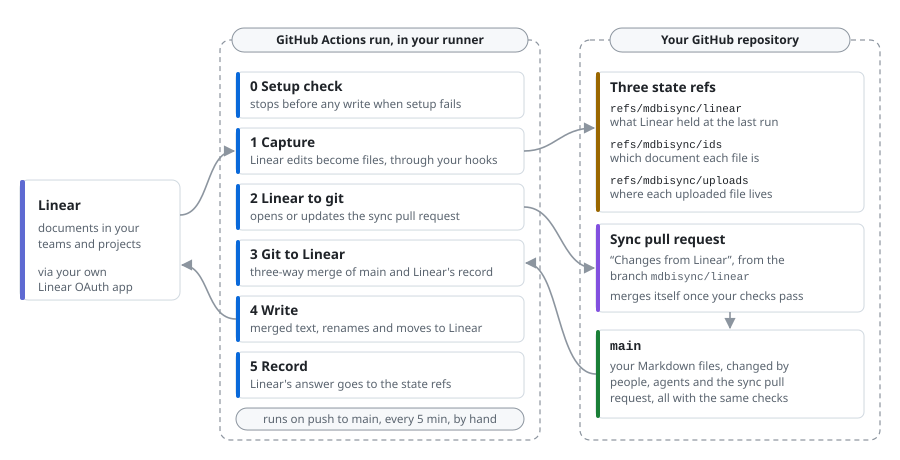

<picture>
  <source media="(prefers-color-scheme: dark)" srcset="docs/images/hero-dark.svg">
  
</picture>

Two-way sync between Linear documents and Markdown in your repository. It runs
as a GitHub Action under apps you create: no server, no webhook, no key we
hold.

## Why

One knowledge base, readable by people and agents.

- **Teams on Linear and git.** Specs, plans and notes stay where product
  people write them, and live as Markdown next to the code they describe.
- **Teams working with AI agents.** Agents read current specs from files and
  write their plans back as files. What they write shows up in Linear for
  people to read.
- **Anyone who wants files.** Your Linear documents in your editor, in grep,
  in backups and in version history, under your control.

Edit in Linear or in git, and both stay in sync.

## Why it is safe

- **Inside your perimeter.** The sync runs in your GitHub Actions runner,
  under a Linear OAuth app and a GitHub App that you create. Nothing runs on
  our side and we hold no key.
- **Short-lived tokens.** Each run gets its own Linear token and revokes it at
  the end. No personal API key.
- **Quality gates before any push.** Changes from Linear pass your
  repository's security and privacy quality gates, the pre-commit hooks you
  mark `alias: security`, before anything is pushed. A rejected change gets a
  red mark in Linear.
- **The same checks as everyone else.** Linear's changes reach `main` through
  a sync pull request, with the same checks as the pull requests of people and
  agents.
- **Merge edits from both sides.** `main` flows back to Linear through a
  three-way merge in the runner. A re-read before writing detects changes to
  tracked documents; edits can still be lost between reading and writing
  ([editing while sync runs](docs/sync-cycle.md#editing-while-sync-runs)).

## How it works

There is no mdbisync service and no database. Each run is a job in your
GitHub Actions runner. The sync's state lives in three refs of your
repository under `refs/mdbisync/`, outside your branches and files, and its
pull requests come from the branches `mdbisync/linear` and
`mdbisync/suspended`.



After the initial sync, changes from Linear reach `main` only through the
sync pull request, which merges itself once your checks pass; a batch that
fails them waits in a suspended pull request. Changes on `main` reach Linear
in the next run, usually within a minute or two. Each step is in
[docs/sync-cycle.md](docs/sync-cycle.md).

## Conflicts

Edits to different paragraphs merge cleanly, even next to each other. When
both sides change the same paragraph between two runs, the run writes both
versions into the document, the same text in Linear and in git, and keeps
syncing everything else:

```markdown
**Sync conflict: git version**

The release ships on Tuesday.

**Sync conflict: Linear version**

The release ships on Wednesday.

**Sync conflict: end**
```

The document gets an alert icon and a comment in Linear. Keep the text you
want and remove the marker paragraphs, in Linear or in git; the next run
takes the result to the other side. A delete against an edit, or two
different renames, is decided by rules instead: a change beats a delete,
and git's path beats Linear's title
([deletes and renames](docs/conflicts.md#deletes-and-renames)). Details:
[docs/conflicts.md](docs/conflicts.md).

## Features

- **Both directions:** edits, new documents, renames, moves and deletes
  travel each way.
- **Folders as teams and projects:** the front matter of a folder's `README.md`
  maps it to a Linear team and project; deeper folders become title paths.
- **Images and files:** files a document links are uploaded to Linear once;
  supported images and documents pasted in Linear land next to the document, in
  Git LFS when your `.gitattributes` says so. An image written in Linear must
  be an upload: an external URL, `data:` URI or path blocks that document
  with a red mark and a comment showing which images to fix. Upload the
  files instead; the next sync clears the comment and restores the icon.
  New uploads must contain PNG, JPEG, GIF, WebP, AVIF, PDF, MP4, WebM or SVG,
  identified from their bytes. SVGs with `script` or `foreignObject` elements,
  animation elements, event attributes, `xml:base` or non-fragment `href`
  references are blocked. Files already
  in the repository keep working. Downloaded files use the detected extension, regardless of
  the upload URL or declared content type. Unreadable uploads (including redirects)
  and files larger than 10 MB block the document with a comment. Access errors
  stop capture; temporary download failures leave the document unmarked and
  listed as `download-retry` in the run summary until a later run succeeds.
- **The `linear-format` hook:** `lint` and `fix` keep Markdown in the form
  Linear stores, so a round trip changes nothing
  ([docs/linear-format.md](docs/linear-format.md)).
- **Security hooks before any push:** your `alias: security` pre-commit
  hooks check Linear's changes; a rejected document gets a red mark in
  Linear and is not committed. Without such hooks the content is not
  checked, and every run summary says so.
- **A sync pull request with your checks:** it merges itself when they pass;
  a failing batch moves to a suspended lane while other documents keep
  syncing.
- **Initial sync with a dry run:** either direction, a dry run first, and a
  rerun that continues where an interrupted one stopped.
- **Recovery:** lost state is rebuilt or refused with a clear message, and an
  initial sync restores it ([docs/troubleshooting.md](docs/troubleshooting.md#recovery-with-initial-sync)).

## Limitations

- Linear documents only: issues, comments, icons and colors are not synced.
  YAML front matter stays in git.
- Linear to git waits for the next scheduled run: GitHub starts schedules
  every five minutes at best, often later, and turns them off in a public
  repository after 60 days without activity.
- A document with Markdown Linear would lose (a footnote, a link title,
  table alignment), an image from the web, a linked file over 10 MB or more
  than 250,000 characters is left out whole: it stays in git only and is
  listed in the run summary until fixed.
- The repository must be on GitHub.

## Setup

Four steps, all in accounts you already own. Each run checks the whole setup
before it writes anything, and says what is missing in the run summary. The
[quickstart](docs/quickstart.md) has every step in order, with the exact
settings and commands.

### 1. Create a private Linear OAuth app

Each run gets a short-lived token and revokes it at the end.

Exact settings and the secrets to set: [Linear OAuth app](docs/quickstart.md#linear-oauth-app).

### 2. Create your own GitHub App

No third-party app to trust: it is yours. Install it only on your docs
repository and keep its key in your secrets.

Exact settings, the secrets to set, and a link that opens GitHub's
new-App form already filled in: [GitHub App](docs/quickstart.md#github-app).

### 3. Run a one-time initial sync

First prepare the repository. `mdbisync init` writes the files for it
([repository files](docs/quickstart.md#repository-files)):

- map a folder to Linear: `linear-team` and `linear-project` in the front
  matter of its `README.md` ([folder mapping](docs/usage.md#folder-mapping));
- add the `linear-format` hook to `.pre-commit-config.yaml`, pinned to a
  release ([pins](docs/usage.md#release-builds-and-pins)), and mark your
  security hooks `alias: security`;
- in the repository settings, turn on **Allow merge commits**.

Then copy [`examples/mdbisync-initial-sync.yml`](examples/mdbisync-initial-sync.yml)
to `.github/workflows/` and run it by hand from the Actions tab, with a
direction: `git-to-linear` makes Linear equal to git, `linear-to-git` opens a
pull request that makes git equal to Linear. The first run is a dry run that
lists what would change; run it again with `confirm` to write.
Before you take documents from Linear, read
[initial sync from Linear to git](docs/initial-sync-linear-to-git.md): its
pull request can remove files, and a person merges it. Before you take
files to Linear, read
[initial sync from git to Linear](docs/initial-sync-git-to-linear.md): it
overwrites documents and moves those without a file to Linear's trash.

### 4. Start ongoing sync

Once the initial sync is done (for `linear-to-git`, once its pull request is
merged), copy [`examples/mdbisync.yml`](examples/mdbisync.yml)
to `.github/workflows/`. It runs on every push to `main` and every five
minutes, in both directions.

## Documentation

- [Quickstart](docs/quickstart.md): the whole setup, step by step.
- [Configuration](docs/configuration.md): every input, secret, hook and flag
  with its default.
- [Usage](docs/usage.md): folder mapping, the setup check, the sync pull
  request and release pins.
- [How the sync works](docs/sync-cycle.md): each run step by step, timing and
  the run summary.
- Initial sync [from git to Linear](docs/initial-sync-git-to-linear.md) and
  [from Linear to git](docs/initial-sync-linear-to-git.md).
- [Linear's Markdown form](docs/linear-format.md), [conflicts](docs/conflicts.md)
  and [troubleshooting](docs/troubleshooting.md).

## License

MIT, see [LICENSE](LICENSE).
