<picture>
  <source media="(prefers-color-scheme: dark)" srcset="docs/images/hero-dark.svg">
  
</picture>

Two-way sync between Linear documents and Markdown in your repository. It runs
as a GitHub Action under apps you create: no server we own, no key we hold.

## Why

**One knowledge base, readable by people and agents.**

- **One to one with your agent, in files.** Specs, plans and documents live as
  Markdown in your repository, where you and the agent read and write them
  together.
- **With your team, in Linear.** The same documents stay in sync in Linear,
  where anyone can edit, discuss and comment on them without git.

## Why it is safe

- **Inside your perimeter.** The sync runs in your GitHub Actions runner,
  under a Linear OAuth app and a GitHub App that you create. Nothing runs on
  our server and we hold no key.
- **Short-lived tokens.** Each run gets its own Linear token and revokes it at
  the end. No personal API key.
- **Quality gates before any push.** Changes from Linear pass your
  repository's security and privacy quality gates. Your pre-commit hooks
  marked with `alias: security` run on every change first, and if one fails,
  nothing is pushed to git. A rejected change gets a red mark in Linear.
- **The same checks as everyone else.** Changes from Linear reach `main`
  through a sync pull request, with the same checks as the pull requests of
  people and agents.
- **Every release reviewed by frontier models.** Each release is reviewed for
  vulnerabilities by two frontier language models, and its security report is
  published with the release (see [Security](#security)).

## How it works

There is no mdbisync service and no database. Each run is a job in your
GitHub Actions runner. The sync's state lives in three refs of your
repository under `refs/mdbisync/`, outside your branches and files. From
them the sync opens its pull requests to `main`.

Two workflows do the work:

- **Initial sync**, run once by hand, in one direction: it makes Linear
  equal to `main`, or opens a pull request that makes `main` equal to Linear.
- **Sync**, run on every push to `main` and on a schedule, keeps both sides
  equal from then on. GitHub's schedule can be late, so for timely runs start
  it from your own timer (see [Scheduler](#scheduler)).

## Conflicts

**A true three-way merge.** Edits from git and from Linear are merged against
the version both sides last agreed on, so changes to different paragraphs
simply combine. When both sides change the same paragraph, the document keeps
both versions and is marked orange in Linear until someone resolves the
conflict.

To resolve it, keep the text you want and remove the conflict markers, in
Linear or in git. See details in [docs/conflicts.md](docs/conflicts.md).

## Features

- **Folders as teams and projects.** Map a folder to a Linear team and
  project in the front matter of its `README.md`; the rest of the path
  becomes part of the document's title in Linear (see
  [Folder mapping](docs/usage.md#folder-mapping)).
- **Images and files, in git and in Linear.** Images and files you add in
  git appear in Linear, and those pasted in Linear are saved to git next to
  the document (see [Images and files](docs/images-and-files.md)).
- **Git LFS support.** Images and files can be stored in Git LFS, and the
  sync reads and writes them there (see [Git LFS](docs/usage.md#generate-repository-files)).
- **Linear's format, checked in your repository.** The `linear-format`
  pre-commit hook's `lint` and `fix` bring your Markdown to the form Linear
  stores before it is synced (see [Linear's Markdown form](docs/linear-format.md)).
- **Your security hooks.** Pre-commit hooks marked with `alias: security`
  check every change from Linear before it reaches git.

## Security

Every release is reviewed by frontier models, GitHub CodeQL and dependency
scanners. (see  [Security reports](https://mdbisync.com/security/report) and  [Dependency scan](https://mdbisync.com/security/dependencies))

  <a href="https://mdbisync.com/security/report">
    <picture>
      <source media="(prefers-color-scheme: dark)" srcset="https://mdbisync.com/badge/security-dark.svg">
      
    </picture>
  </a>

## Limitations

- Linear documents only: issues, comments, icons and colors are not synced.
  YAML front matter stays in git.
- Between pushes, a Linear edit reaches git only with the next run, and
  GitHub's schedule can start it hours late (see [Scheduler](#scheduler)).
- A document with Markdown Linear would lose (a footnote, a link title,
  table alignment), an image from the web, a linked file over 10 MB or more
  than 250,000 characters is left out whole: it stays in git only and is
  listed in the run summary until fixed.
- An edit made in Linear while a run is writing that same document can be
  lost
  ([editing while sync runs](docs/sync-cycle.md#editing-while-sync-runs)).
- The repository must be on GitHub.

## Setup

Four steps, all in accounts you already own. Each run checks the whole setup
before it writes anything, and says what is missing in the run summary. The
[quickstart](docs/quickstart.md) has every step in order, with the exact
settings and commands.

### 1. Create a private Linear OAuth app

Each run gets a short-lived token and revokes it at the end.

Exact settings and the secrets to set: [Linear OAuth app](docs/quickstart.md#linear-oauth-app).

### 2. Create your own GitHub App

No third-party app to trust: it is yours. Install it only on your docs
repository and keep its key in your secrets.

Exact settings, the secrets to set, and a link that opens GitHub's
new-App form already filled in: [GitHub App](docs/quickstart.md#github-app).

### 3. Run a one-time initial sync

First prepare the repository. `mdbisync init` writes the workflows, the
folder annotations and the `linear-format` hook, and with
`--security-hooks` two example security hooks; marking hooks of your own
`alias: security` and the repository setting are yours
([repository files](docs/quickstart.md#repository-files)):

- map a folder to Linear: `linear-team` and `linear-project` in the front
  matter of its `README.md` ([folder mapping](docs/usage.md#folder-mapping));
- add the `linear-format` hook to `.pre-commit-config.yaml`, pinned to a
  release ([pins](docs/usage.md#release-builds-and-pins)), and mark your
  security hooks `alias: security`;
- in the repository settings, turn on **Allow merge commits**.

Commit what `init` wrote and push it to `main`
([commit the files](docs/quickstart.md#commit-the-files)). Then run the
initial sync workflow, `.github/workflows/mdbisync-initial-sync.yml`,
by hand from the Actions tab, with a direction: `git-to-linear` makes Linear
equal to git, `linear-to-git` opens a pull request that makes git equal to
Linear. The first run is a dry run that lists what would change; run it
again with `confirm` to write. Without `init`, copy the workflow from
[`examples/mdbisync-initial-sync.yml`](examples/mdbisync-initial-sync.yml)
and replace each `mdbisync/mdbisync@…` pin with your release. Before the
first run, disable the sync workflow (Actions → **mdbisync** → `⋯` →
**Disable workflow**): it shares one queue with the initial sync, and a
queued sync run can replace a waiting initial sync.
Before you take documents from Linear, read
[initial sync from Linear to git](docs/initial-sync-linear-to-git.md): its
pull request can remove files, and a person merges it. Before you take
files to Linear, read
[initial sync from git to Linear](docs/initial-sync-git-to-linear.md): it
overwrites documents and moves those without a file to Linear's trash.

### 4. Start ongoing sync

The sync workflow, `.github/workflows/mdbisync.yml`, is one of the files
`init` writes (without `init`, copy
[`examples/mdbisync.yml`](examples/mdbisync.yml) and replace its pins).
Once the initial sync is done (for `linear-to-git`, once its pull request
is merged), enable it again. It runs on every push to
`main`, on GitHub's schedule and by hand, in both directions.

Do not rely on GitHub's schedule to bring Linear edits to git: start the
workflow from a timer of your own (see [Scheduler](#scheduler)).

## Scheduler

A push to `main` starts a sync run at once. A Linear edit waits for the
next run, and GitHub's schedule can start it hours late or skip it, and
turns itself off in a public repository after 60 days without activity.

For timely runs, start the sync workflow every few minutes from a timer of
your own (cron, a systemd timer or another scheduler), with a token that may
only start workflows in this repository. Keep GitHub's schedule as a
fallback (see [Run the sync from your own scheduler](docs/own-scheduler.md)).

## Documentation

- [Quickstart](docs/quickstart.md): the whole setup, step by step.
- [Configuration](docs/configuration.md): every input, secret, hook and flag
  with its default.
- [Usage](docs/usage.md): folder mapping, the setup check, the sync pull
  request and release pins.
- [How the sync works](docs/sync-cycle.md): each run step by step, timing and
  the run summary.
- [Your own scheduler](docs/own-scheduler.md): start the sync on time from
  cron, a systemd timer or another scheduler.
- Initial sync [from git to Linear](docs/initial-sync-git-to-linear.md) and
  [from Linear to git](docs/initial-sync-linear-to-git.md).
- [Images and files](docs/images-and-files.md): how files travel between
  git and Linear, and which uploads are accepted.
- [Linear's Markdown form](docs/linear-format.md), [conflicts](docs/conflicts.md)
  and [troubleshooting](docs/troubleshooting.md).

## License

MIT, see [LICENSE](LICENSE).
