<picture>
  <source media="(prefers-color-scheme: dark)" srcset="docs/images/hero-dark.svg">
  
</picture>

Two-way sync between Linear documents and Markdown in your repository. It runs
as a GitHub Action under apps you create: no server, no webhook, no key we
hold.

## Why

One knowledge base, readable by people and agents.

- **Teams on Linear and git.** Specs, plans and notes stay where product
  people write them, and live as Markdown next to the code they describe.
- **Teams working with AI agents.** Agents read current specs from files and
  write their plans back as files. What they write shows up in Linear for
  people to read.
- **Anyone who wants files.** Your Linear documents in your editor, in grep,
  in backups and in version history, under your control.

Edit in Linear or in git, and both stay in sync.

## Why it is safe

- **Inside your perimeter.** The sync runs in your GitHub Actions runner,
  under a Linear OAuth app and a GitHub App that you create. Nothing runs on
  our side and we hold no key.
- **Short-lived tokens.** Each run gets its own Linear token and revokes it at
  the end. No personal API key.
- **Quality gates before any push.** Changes from Linear pass your
  repository's security and privacy quality gates, the pre-commit hooks you
  mark `alias: security`, before anything is pushed. A rejected change gets a
  red mark in Linear.
- **The same checks as everyone else.** Linear's changes reach `main` through
  a sync pull request, with the same checks as the pull requests of people and
  agents.
- **No lost edits.** `main` flows back to Linear through a three-way merge in
  the runner, so edits made on both sides are merged, not replaced.

## Setup

Four steps, all in accounts you already own. Each run checks the whole setup
before it writes anything, and says what is missing in the run summary.

### 1. Create a private Linear OAuth app

Each run gets a short-lived token and revokes it at the end.

Exact settings and the secrets to set: [Linear OAuth app](docs/quickstart.md#linear-oauth-app).

### 2. Create your own GitHub App

No third-party app to trust: it is yours. Install it only on your docs
repository and keep its key in your secrets.

Exact settings, the secrets to set, and a link that opens GitHub's
new-App form already filled in: [GitHub App](docs/quickstart.md#github-app).

### 3. Run a one-time initial sync

First prepare the repository:

- map a folder to Linear: `linear-team` and `linear-project` in the front
  matter of its `README.md` ([folder mapping](docs/usage.md#folder-mapping));
- add the `linear-format` hook to `.pre-commit-config.yaml`, pinned to a
  release ([pins](docs/usage.md#pre-release-builds-and-pins)), and mark your
  security hooks `alias: security`;
- in the repository settings, turn on **Allow merge commits**.

Then copy [`examples/mdbisync-initial-sync.yml`](examples/mdbisync-initial-sync.yml)
to `.github/workflows/` and run it by hand from the Actions tab, with a
direction: `git-to-linear` makes Linear equal to git, `linear-to-git` opens a
pull request that makes git equal to Linear. The first run is a dry run that
lists what would change; run it again with `confirm` to write.
Before you take documents from Linear, read
[initial sync from Linear to git](docs/initial-sync-linear-to-git.md): its
pull request can remove files, and a person merges it.

### 4. Start ongoing sync

Once the initial sync is done (for `linear-to-git`, once its pull request is
merged), copy [`examples/mdbisync.yml`](examples/mdbisync.yml)
to `.github/workflows/`. It runs on every push to `main` and every five
minutes, in both directions.

## Documentation

How folders map to Linear, the checks every run makes, the sync pull request
and how to pin a release: [docs/usage.md](docs/usage.md). How a change
travels each way, what you see in GitHub and Linear, how long it takes and
what each run's summary says: [docs/sync-cycle.md](docs/sync-cycle.md). The
initial sync from Linear to git, step by step:
[docs/initial-sync-linear-to-git.md](docs/initial-sync-linear-to-git.md). How
Markdown is kept in Linear's form: [docs/linear-format.md](docs/linear-format.md).
What happens when both sides change one document, and how to resolve a
conflict: [docs/conflicts.md](docs/conflicts.md). What each message means,
what to do about it, and how to recover with an initial sync:
[docs/troubleshooting.md](docs/troubleshooting.md).

### Tokens left by interrupted jobs

The action revokes each run's Linear token when it ends and retries in its
`post` step, including failed and cancelled jobs. A runner that disappears
before post can execute can leave an active token behind.

The example workflows leave `cleanup-tokens: false`. Enable it before staging
with `cleanup-tokens: true` to clean orphan tokens automatically. This
requires a **dedicated Linear OAuth app** used only by these two workflows
in this repository, both in the same `concurrency` group. Cleanup requests
read-only scopes and then restores read/write scopes, replacing the app's
existing tokens in that workspace. Do not enable it when another repository,
process or test worker uses the same app; leave it false and revoke stale
tokens during an exclusive maintenance window instead.

## License

MIT, see [LICENSE](LICENSE).
