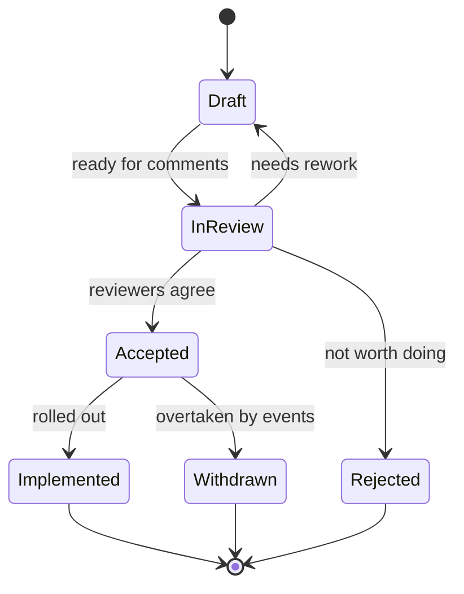

| Owner | DemoAlice |
| -- | -- |
| Updated | 2026-02-02 |
| Applies to | Every change that affects more than one service, a public interface, or data that is hard to migrate |

An RFC (request for comments) is how DemoCompany's engineers propose a change before building it. It lets the people affected find problems while they are still cheap to fix. Decisions that come out of an RFC and are hard to reverse are then recorded as ADRs (see the [ADR template](<ADR template.md>)).

## When to write one

* A new service, or a service taking over responsibility from another.
* A change to a public API, an event schema or a shared database.
* A new technology in production.
* Anything that needs more than two weeks of work from more than one team.

Bug fixes, refactoring inside one service and changes behind an existing flag do not need an RFC.

## Lifecycle

| Status | Meaning | Typical length of stay |
| -- | -- | -- |
| Draft | The author is still writing; comments welcome but not expected | 1 to 5 days |
| In review | Named reviewers are asked to comment | 5 working days |
| Accepted | Agreed; work can be planned | until rolled out |
| Implemented | Rolled out; the RFC is now history | permanent |
| Rejected | Not done, with reasons recorded | permanent |
| Withdrawn | Overtaken by other work | permanent |

## Writing one

1. Copy the structure of a recent RFC: status table, Summary, Motivation, Proposal, Alternatives, Rollout, Open questions.
2. Number it with the next free RFC number and put it in the project folder it belongs to.
3. Name at least two reviewers, one from each team the change touches.
4. Lead with numbers: what is slow, how slow, how often.

## Reviewing one

- [ ] Is the problem real, and measured?
- [ ] Is the simplest alternative listed, and is it clear why it is not enough?
- [ ] Does the rollout have a way back?
- [ ] Are security, privacy and cost covered?
- [ ] Is there a decision that needs an ADR?

## Numbers so far

| Year | RFCs written | Accepted | Rejected or withdrawn | Median days in review |
| -- | -- | -- | -- | -- |
| 2025 | 46 | 38 | 8 | 6 |
| 2026 (to October) | 35 | 29 | 6 | 5 |
