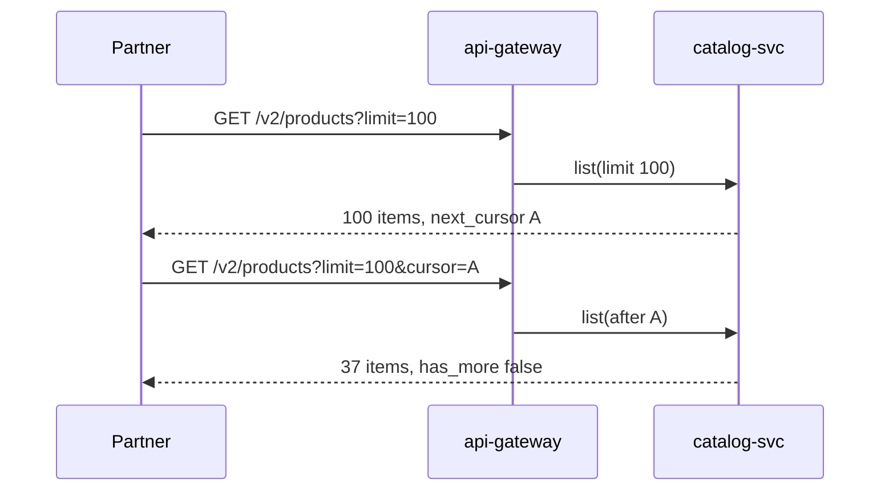

| Status | Implemented |
| -- | -- |
| Created | 2025-06-24 |
| Authors | DemoJudy |
| Reviewers | DemoErin, DemoIvan |
| Target | Public API v2 |
| Decision | Part of [RFC-030 Public API v2](@RFC-030) |

## Summary

Every list endpoint in v2 pages with an opaque cursor and a `limit`, never with an offset. Responses carry the cursor of the next page, or none on the last page.

## Motivation

Version 1 lists used `offset` and `limit`. On the largest catalogs, with more than 400,000 products, a page at offset 80,000 took 2.9 s at p95, and partners that synchronised a full catalog every night hit the 10 s gateway timeout ([RN-031](@RN-031)). Items inserted or deleted during a scan also shifted the offsets, so partners saw duplicates or missed items: 0.4 % of items in a full scan, measured on a busy afternoon.

## Proposal

### Request and response

```http
GET /v2/products?limit=100&cursor=eyJpZCI6InByZF8wMUo4WCIsInUiOiIyMDI1LTA2LTI0In0 HTTP/1.1
Host: api.example.com
Authorization: Bearer dm_test_8f2c41
```

```json
{
  "data": [
    { "id": "prd_01J8X4K2", "title": "Oak side table", "updated_at": "2025-06-24T08:14:03Z" }
  ],
  "next_cursor": "eyJpZCI6InByZF8wMUo4WDRLMyIsInUiOiIyMDI1LTA2LTI0In0",
  "has_more": true
}
```

### Rules

* `limit` is 1 to 200, default 50.
* The cursor encodes the sort key of the last item returned (for products, `updated_at` and `id`). The server reads the next page with a keyset condition, so every page costs the same.
* Cursors are opaque base64url. They are valid for 24 hours; an expired cursor returns `400` with the problem type `cursor-expired` ([SPEC-032](@SPEC-032)).
* Filters cannot change between pages; the cursor carries a hash of them.

```sql
SELECT id, title, updated_at
FROM products
WHERE seller_id = $1
  AND (updated_at, id) > ($2, $3)
ORDER BY updated_at, id
LIMIT $4;
```



## Alternatives

| Option | Cost of a deep page | Stable under inserts | Jump to page n | Verdict |
| -- | -- | -- | -- | -- |
| Offset and limit (v1) | grows with the offset | no | yes | Too slow on large catalogs |
| Page tokens kept on the server | constant | yes | no | State to store and expire |
| **Keyset cursor in the token** | **constant** | **yes** | **no** | Chosen |

Partners did not ask to jump to a page; every v1 client we looked at scanned from the start.

## Rollout

- [X] Keyset queries in `catalog-svc` and `orders-svc`
- [X] Cursor helpers in the generated SDKs ([RFC-035](@RFC-035))
- [X] All v2 list endpoints use cursors ([SPEC-033](@SPEC-033))

## Open questions

* Should cursors last longer than 24 hours for very slow consumers? No partner has needed it so far.
