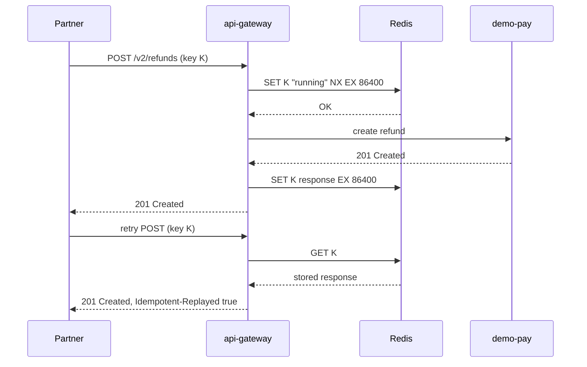

| Status | Implemented |
| -- | -- |
| Created | 2025-08-05 |
| Authors | DemoErin |
| Reviewers | DemoJudy, DemoCarol, DemoOscar |
| Target | Public API v2 |
| Decision | [ADR-019 Require idempotency keys on mutating API calls](@ADR-019) |

## Summary

Every `POST` and `PATCH` in the public API takes an `Idempotency-Key` header. The gateway stores the first response for a key for 24 hours and returns it again for a retry with the same key and body, so a network retry never creates a second order, refund or shipment.

## Motivation

Partners retry on timeouts, as they should. Without a way to tell a retry from a new request, the server cannot know whether to act again. In July 2025 we found:

* 0.31 % of `POST /v1/refunds` calls were duplicates within 60 seconds, and 41 of them paid a refund twice in one month ([RN-037](@RN-037)).
* 0.18 % of shipment confirmations were duplicates, which sent buyers two "your order has shipped" messages.
* Partners worked around it with their own lookups before each write, adding a read for every write.

## Proposal

### Behaviour

```http
POST /v2/refunds HTTP/1.1
Host: api.example.com
Authorization: Bearer dm_test_8f2c41
Idempotency-Key: 4d0f7f3e-1b8a-4c51-9f0e-2a6c7d93b1aa
Content-Type: application/json

{ "order_id": "ord_01J9QW2E", "amount": 2499, "currency": "EUR", "reason": "damaged" }
```

| Situation | Response |
| -- | -- |
| New key | Process the request; store status, headers and body |
| Same key, same body, first request finished | Return the stored response with `Idempotent-Replayed: true` |
| Same key, same body, first request still running | `409` with problem type `request-in-progress` |
| Same key, different body | `422` with problem type `idempotency-key-reused` |
| No key on a mutating call | `400` with problem type `idempotency-key-required` |

Keys are 1 to 255 printable characters; we recommend UUIDs. A key belongs to one partner, so two partners can use the same key.

### Storage



The stored record holds a SHA-256 of the request body to detect a reused key. Responses with status `5xx` are not stored, so a retry after a server error runs again.

## Alternatives

| Option | Covers every endpoint | Partner effort | Why not |
| -- | -- | -- | -- |
| Natural keys per resource (for example the partner's own refund id) | no | low | Every resource needs its own rule |
| Deduplicate in each service | yes | none | Twelve implementations of the same thing |
| **Header handled by the gateway** | **yes** | **one header** | Chosen |

## Rollout

- [X] Optional header in v2 beta
- [X] SDKs add a key to every mutating call automatically ([SPEC-044](@SPEC-044))
- [X] Required for refunds and shipments
- [X] Required for every mutating call, 2025-11-18 ([SPEC-035](@SPEC-035))

## Open questions

* Should keys live longer than 24 hours for import jobs? Import jobs have their own job id ([SPEC-041](@SPEC-041)), so no.
