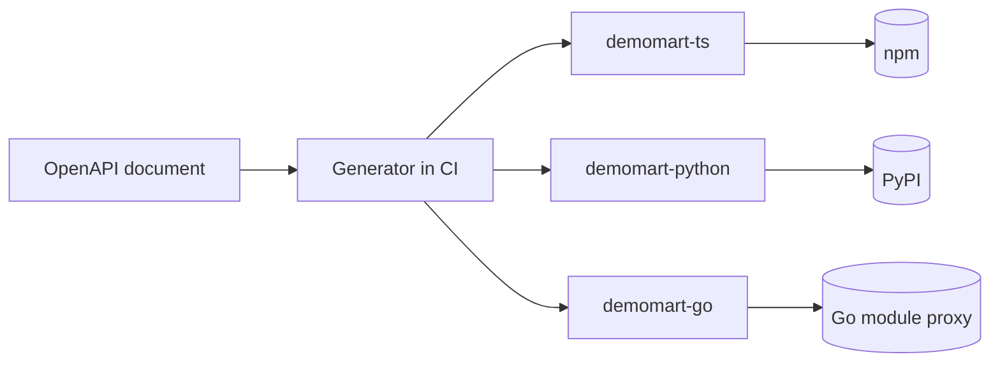

| Status | Implemented |
| -- | -- |
| Created | 2025-10-14 |
| Authors | DemoJudy |
| Reviewers | DemoErin, DemoMike |
| Target | Q1 2026 |
| Decision | [ADR-007 Expose a REST API with OpenAPI 3.1 to partners](@ADR-007) |

## Summary

Generate client libraries for TypeScript, Python and Go from the v2 OpenAPI document on every API release, wrap them in a thin hand-written layer for pagination, retries and idempotency, and publish them to each language's public package registry.

## Motivation

Partners integrate in many languages, and most of them write the same plumbing: authentication, retries on `429` and `5xx`, cursor loops and webhook signature checks. In our review of 30 partner integrations ([RN-040](@RN-040)):

* 19 had no retry with backoff, 7 retried mutating calls without idempotency keys.
* 11 compared webhook signatures with a plain string comparison.
* Integrations took a median of 11 days to the first order; the three that used a community library took 4.

## Proposal

### Generation

The OpenAPI document ([SPEC-030](@SPEC-030)) is the only input. A CI job runs the generator for each language when the document changes and opens a pull request in each SDK repository.



### The hand-written layer

| Concern | Behaviour in every SDK |
| -- | -- |
| Authentication | Fetches and refreshes OAuth tokens ([SPEC-031](@SPEC-031)) |
| Retries | Exponential backoff with jitter on `429`, `502`, `503`, `504`; honours `Retry-After` |
| Idempotency | Adds a UUID `Idempotency-Key` to every mutating call and keeps it across retries |
| Pagination | Iterators that follow `next_cursor` ([SPEC-033](@SPEC-033)) |
| Webhooks | A constant-time signature check ([SPEC-039](@SPEC-039)) |

```typescript
import { DemoMart } from "demomart";

const client = new DemoMart({ clientId: "dm_test_client", clientSecret: process.env.DEMOMART_SECRET });

for await (const order of client.orders.list({ status: "paid" })) {
  await client.orders.createShipment(order.id, { carrier: "demo-post", tracking_number: "DP123456789" });
}
```

### Versions

SDK major versions follow API versions: `2.x` talks to `/v2/`. Minor versions add endpoints; a breaking change in an SDK's own layer needs a new major version and 6 months of support for the old one ([SPEC-044](@SPEC-044)).

## Alternatives

| Option | Languages | Maintenance | Why not |
| -- | -- | -- | -- |
| Publish only the OpenAPI document | any | none | Leaves retries and signatures to every partner |
| Fully hand-written SDKs | 3 | high | Falls behind the API |
| **Generated core plus thin layer** | **3** | **low** | Chosen |

## Rollout

- [X] TypeScript SDK 2.0
- [X] Python SDK 2.0
- [X] Go SDK 2.0
- [X] Code samples in the API reference use the SDKs
- [X] Adoption measured after three months ([RN-035](@RN-035))

## Open questions

* Java and PHP: worth it when they reach 10 % of partner traffic; neither has.
