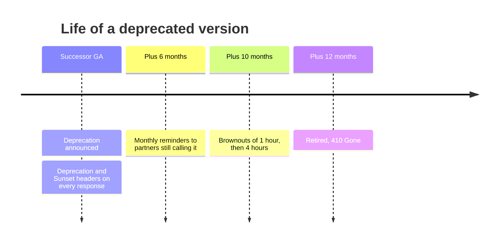

| Status | Accepted |
| -- | -- |
| Created | 2025-12-02 |
| Authors | DemoErin |
| Reviewers | DemoNina, DemoPeggy, DemoAlice |
| Target | Applies from 2026-01-01 |
| Decision | [ADR-044 Retire public API v1 by June 2026](@ADR-044) |

## Summary

A published API version or endpoint is supported for at least 12 months after its successor is generally available. Deprecation is announced in the changelog, in response headers and to every partner still calling it; retirement happens on a fixed date with brownouts before it.

## Motivation

Version 2 became generally available on 2025-11-18 ([RFC-030](@RFC-030)). We need a rule for when v1 goes away, and for the endpoints that will change inside v2. Without one, every removal is a negotiation, and partners cannot plan: in 2024 a v1 field removal broke 6 partners who had not read an email.

## Proposal

### Timeline

### Rules

1. **Minimum support:** 12 months from the successor's general availability, for versions and for single endpoints.
2. **Headers:** every response from a deprecated endpoint carries `Deprecation` and `Sunset` with the retirement date and a `Link` to the migration guide ([SPEC-042](@SPEC-042)).
3. **Direct notice:** partners that called the endpoint in the last 30 days get a notice in Seller Hub and in the partner portal at announcement, at 6 months and monthly after that. Partners are not named in public status pages.
4. **Brownouts:** in the last two months, the endpoint returns `410` for announced windows (1 hour, then 4 hours), so forgotten clients surface before the final date.
5. **Retirement:** after the date, `410 Gone` with a problem type `version-retired` for 90 days, then `404`.
6. **Exceptions:** security fixes may shorten the timeline; the reason is published in the changelog ([RFC-041](@RFC-041)).

### Applied to v1

| Date | Step |
| -- | -- |
| 2025-11-18 | v2 generally available |
| 2026-01-05 | v1 deprecated; headers on |
| 2026-05-12 | First brownout, 1 hour |
| 2026-06-02 | Second brownout, 4 hours |
| 2026-06-30 | v1 retired |

This is shorter than 12 months; the exception is recorded in [ADR-044](@ADR-044): v1 lacks idempotency keys and caused double refunds ([RN-037](@RN-037)).

## Alternatives

| Option | Predictable for partners | Cost of old versions | Why not |
| -- | -- | -- | -- |
| Support every version forever | yes | grows without bound | Two stacks to secure and run |
| Retire when traffic falls below 1 % | no | low | Partners cannot plan for a moving date |
| **Fixed minimum with brownouts** | **yes** | **bounded** | Chosen |

## Rollout

- [X] Policy published in the partner portal
- [X] `Deprecation` and `Sunset` headers in `api-gateway`
- [X] Report of partners still calling deprecated endpoints ([RN-038](@RN-038))
- [ ] Automatic monthly notices

## Open questions

* Should brownouts skip partners that have already migrated most of their traffic? Not for v1; reconsider for the next retirement.
