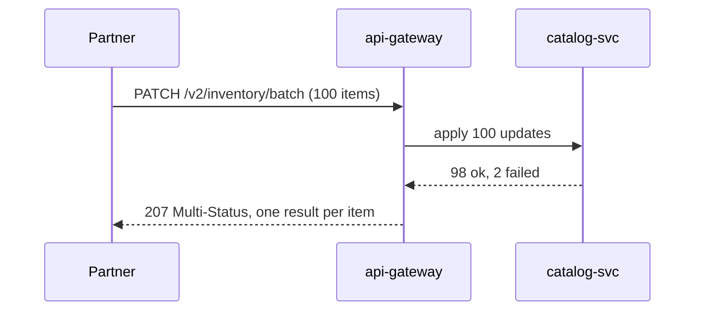

| Status | Rejected |
| -- | -- |
| Created | 2026-01-20 |
| Authors | DemoFrank |
| Reviewers | DemoErin, DemoIvan, DemoJudy |
| Target | Q2 2026 |
| Decision | Rejected at the API review, 2026-02-05, in favour of import jobs ([SPEC-041](@SPEC-041)) |

## Summary

Add synchronous batch endpoints, `POST /v2/products/batch` and `PATCH /v2/inventory/batch`, that create or update up to 100 items in one request and answer with a result per item.

This RFC was **rejected**. The review chose asynchronous import jobs instead; the reasoning is kept here because the question comes back.

## Motivation

Partners that sell on several marketplaces push their whole catalog to us. A partner with 60,000 products sends 60,000 `PATCH` calls for a price update, which at the write limit of 10 per second ([RFC-033](@RFC-033)) takes 100 minutes. In January 2026, 4 partners made up 52 % of all write calls, almost all of them price and stock updates ([RN-029](@RN-029)).

## Proposal

```http
PATCH /v2/inventory/batch HTTP/1.1
Host: api.example.com
Authorization: Bearer dm_test_8f2c41
Idempotency-Key: 0c7f6a21-3e4b-4d8e-b1c2-9a8f7e6d5c4b
Content-Type: application/json

{
  "items": [
    { "variant_id": "var_01J8X4K2", "available": 12 },
    { "variant_id": "var_01J8X4K3", "available": 0 }
  ]
}
```

```json
{
  "results": [
    { "variant_id": "var_01J8X4K2", "status": 200 },
    { "variant_id": "var_01J8X4K3", "status": 404, "problem": { "type": "not-found" } }
  ]
}
```

A batch counts as one write against the rate limit, has a 30 second timeout, and is not atomic: each item succeeds or fails on its own.



## Why it was rejected

The review measured a prototype against the import job design ([RN-034](@RN-034)):

| Measure | Batch endpoint, 100 items | Import job, 60,000 items |
| -- | -- | -- |
| Time for 60,000 price updates | 9.8 min | 2.1 min |
| p99 latency of a single request | 6.4 s | 0.2 s to accept the file |
| Gateway timeouts during the test | 1.7 % of batches | none |
| Partner code for retries of partial failures | per item | download one error report |

* Large synchronous requests hold gateway connections and push p99 latency up for everyone.
* A partial failure leaves the partner to work out which items to retry; a job's error report says it once.
* Partners who push whole catalogs already produce files; asking them to cut those into batches of 100 adds code on their side.

## Alternatives

| Option | Throughput | Effect on other traffic | Verdict |
| -- | -- | -- | -- |
| Single-item calls (today) | 10 per second | none | Too slow for full catalogs |
| Synchronous batches (this RFC) | about 100 per second | long requests at the gateway | Rejected |
| **Asynchronous import jobs** | **about 480 per second** | **none, runs in workers** | Chosen ([SPEC-041](@SPEC-041)) |

## Rollout

- [X] Prototype measured ([RN-034](@RN-034))
- [X] Decision recorded; import jobs specified instead

## Open questions

* Would a small batch of up to 10 items for stock changes in real time still help? Revisit if partners ask for it after import jobs ship.
