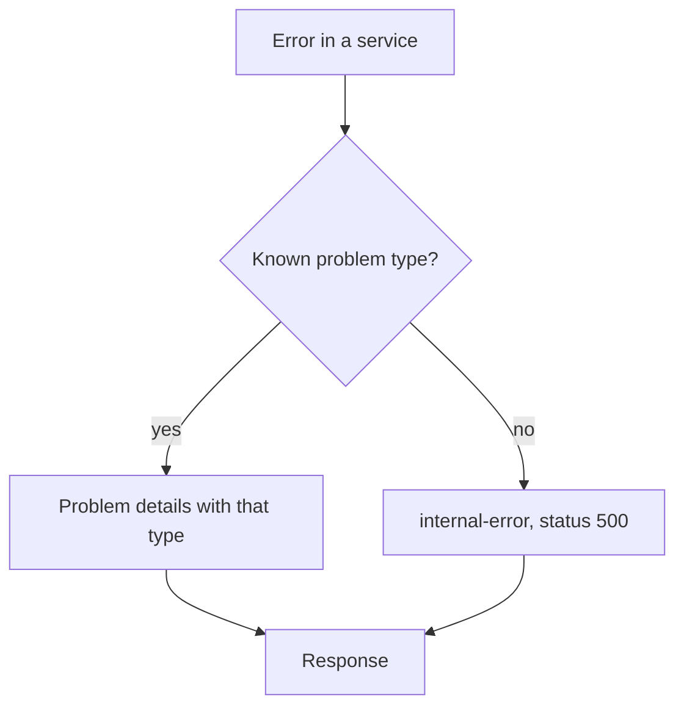

| Status | Implemented |
| -- | -- |
| Created | 2025-06-17 |
| Authors | DemoJudy |
| Reviewers | DemoErin, DemoFrank |
| Target | Public API v2 |
| Decision | Part of [RFC-030 Public API v2](@RFC-030) |

## Summary

All v2 errors use one JSON shape, Problem Details for HTTP APIs (RFC 9457), served as `application/problem+json`, with a stable `type` per error that partners can branch on.

## Motivation

Version 1 had 9 error formats. Some endpoints returned `{"error": "..."}`, some `{"errors": [...]}`, some plain text, and validation errors sometimes came back with status `200` and an `ok: false` field. Partner code we reviewed ([RN-040](@RN-040)) matched error message strings in 14 of 30 integrations, which broke every time we reworded a message. Error rates by version are in [RN-033](@RN-033).

## Proposal

### Shape

```json
{
  "type": "https://api.example.com/problems/validation-failed",
  "title": "The request body is not valid",
  "status": 422,
  "detail": "2 fields failed validation",
  "instance": "/v2/products/prd_01J8X4K2",
  "request_id": "req_01JAB3Y6M2",
  "errors": [
    { "field": "price.amount", "code": "must_be_positive" },
    { "field": "title", "code": "too_long", "max_length": 140 }
  ]
}
```

| Member | Meaning |
| -- | -- |
| `type` | Stable URI for the error class; partners branch on it |
| `title` | Short, human-readable, may change |
| `status` | The HTTP status, repeated for logs |
| `detail` | Explanation for this occurrence |
| `instance` | The request path |
| `request_id` | Our id for support; also in the `X-Request-Id` header |
| `errors` | Field-level problems, only for `validation-failed` |

### Mapping



Services return gRPC status codes with a problem type in the error details; `api-gateway` turns them into problem details. Unknown errors never leak service messages: they become `internal-error` with a request id. The full list of types is in [SPEC-032](@SPEC-032).

## Alternatives

| Option | Standard | Field errors | Why not |
| -- | -- | -- | -- |
| Keep v1 formats | no | partly | The problem we have |
| JSON:API errors | yes | yes | Pulls in the rest of JSON:API, which we do not use |
| Google API error model | de facto | yes | Tied to gRPC conventions partners do not know |
| **RFC 9457 problem details** | **yes** | **with an extension** | Chosen |

## Rollout

- [X] Problem types catalogued for every v2 endpoint
- [X] Gateway mapping from gRPC status to problem details
- [X] SDKs raise typed exceptions per problem type ([SPEC-044](@SPEC-044))
- [X] Problem type pages published in the API reference

## Open questions

* Should `title` be localised? No: partners log it; buyers never see it.
