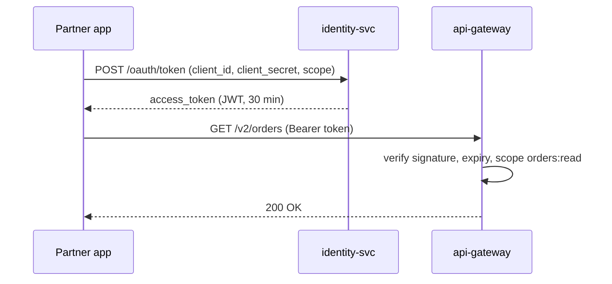

| Status | Implemented |
| -- | -- |
| Created | 2025-07-22 |
| Authors | DemoNina |
| Reviewers | DemoErin, DemoHeidi, DemoOscar |
| Target | Public API v2 |
| Decision | [ADR-017 Authenticate partners with OAuth 2.0 client credentials](@ADR-017) |

## Summary

Partner apps get access tokens through the OAuth 2.0 client credentials grant, limited by scopes per resource and action. A token carries only the scopes the app asked for and was granted, and lives 30 minutes.

## Motivation

Version 1 authenticates with one static API key per partner that can do everything the partner's account can. In June 2025:

* 27 % of partners used the same key in a public storefront plugin and in back-office scripts, so a leaked key could issue refunds.
* Keys never expired; the oldest active key was from 2021.
* We could not tell a partner's read-only reporting tool from its order system in logs.

## Proposal

### Scopes

| Scope | Allows |
| -- | -- |
| `products:read` | List and read products and variants |
| `products:write` | Create, update and delete products |
| `inventory:read` | Read stock levels |
| `inventory:write` | Change stock levels, start import jobs |
| `orders:read` | List and read orders and shipments |
| `orders:write` | Confirm orders, create shipments |
| `refunds:write` | Create refunds |
| `webhooks:manage` | Create and delete webhook subscriptions |

A partner creates one app per system in the partner portal and picks its scopes. Refunds need a separate approval step in the portal before the scope can be granted.

### Token flow



```sh
curl -X POST https://api.example.com/oauth/token \
  -d grant_type=client_credentials \
  -d client_id=dm_test_client_7Q2 \
  -d client_secret="$DEMOMART_SECRET" \
  -d scope="orders:read orders:write"
```

Tokens are JWTs signed with keys from `identity-svc`'s JWKS endpoint; the gateway verifies them locally and caches the keys for 10 minutes. A client secret can have two active versions during rotation. The full reference is [SPEC-031](@SPEC-031).

## Alternatives

| Option | Least privilege | Expiry | Partner effort | Verdict |
| -- | -- | -- | -- | -- |
| Static keys (v1) | no | never | none | Being replaced |
| Static keys with scopes | yes | never | none | Leaked keys stay valid |
| OAuth authorisation code flow | yes | yes | user consent screens | No user is present in server-to-server calls |
| Mutual TLS client certificates | per certificate | yes | high | Hard for small partners |
| **Client credentials with scopes** | **yes** | **30 minutes** | **low** | Chosen |

## Rollout

- [X] `identity-svc` issues tokens with scopes
- [X] Gateway verifies tokens and scopes on v2
- [X] Partner portal: apps, scopes and secret rotation
- [X] SDKs fetch and refresh tokens ([RFC-035](@RFC-035))

## Open questions

* Should apps be able to restrict tokens to a list of seller accounts? Requested by two partners; planned after v1 retires.
