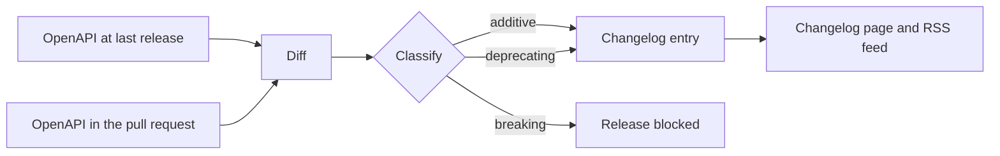

| Status | In review |
| -- | -- |
| Created | 2026-04-14 |
| Authors | DemoJudy |
| Reviewers | DemoErin, DemoMike |
| Target | Q3 2026 |
| Decision | Pending |

## Summary

Generate the API changelog from the differences between released versions of the OpenAPI document, classify each change as additive, deprecating or breaking, and block a release that contains a breaking change outside the deprecation policy.

## Motivation

The changelog is written by hand today. Between v2.0 and v2.6:

* 23 of 61 changes (38 %) never reached the changelog, among them 4 new required response fields that partners' strict parsers rejected.
* Two changes were breaking (a removed enum value and a narrowed field type) and shipped without notice, against [RFC-037](@RFC-037).
* Partners asked for a feed they can subscribe to; 11 requests in Q1 2026.

## Proposal

### Pipeline



### Classification

| Change | Class |
| -- | -- |
| New endpoint, new optional request field, new response field | Additive |
| New enum value in a response | Additive, flagged: strict clients may break |
| Field or endpoint marked `deprecated: true` | Deprecating |
| Removed endpoint or field, new required request field, narrowed type, removed enum value | Breaking |

A breaking change passes only if the removed element was deprecated at least 12 months earlier and its `x-sunset` date has passed ([SPEC-042](@SPEC-042)).

### Entry format

```yaml
- version: 2.7.0
  date: 2026-07-01
  changes:
    - class: additive
      path: /v2/orders/{order_id}
      summary: Response field `estimated_delivery` added
    - class: deprecating
      path: /v2/products
      summary: Query parameter `category_name` deprecated; use `category_id`
      sunset: 2027-07-01
```

Entries render on the changelog page and in an RSS feed. Pull requests get a comment listing the classified changes before merge.

## Alternatives

| Option | Complete | Catches breaking changes | Effort | Why not |
| -- | -- | -- | -- | -- |
| Hand-written changelog (today) | no | no | per release | 38 % of changes missing |
| Commit messages as changelog | partly | no | low | Commits describe code, not the contract |
| **Diff of the OpenAPI document** | **yes** | **yes** | **medium** | Proposed |

## Rollout

- [ ] Diff and classification as a CI check, report only
- [ ] Generated changelog page next to the hand-written one for two releases
- [ ] Release gate for breaking changes
- [ ] RSS feed announced to partners

## Open questions

* Should a new enum value in a response be breaking? Our SDKs tolerate unknown values ([SPEC-044](@SPEC-044)); hand-written clients may not. Proposed: additive, with a warning.
* Who can approve an exception to the gate? Proposed: the API review, recorded in the changelog entry.
