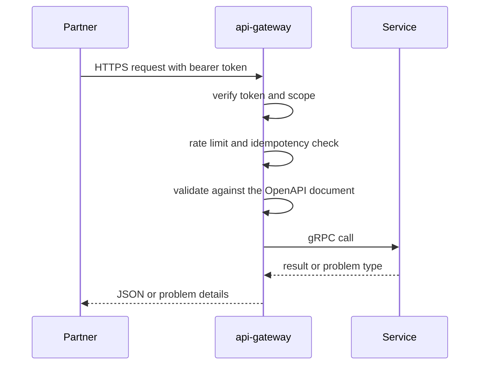

| Status | Stable |
| -- | -- |
| Version | 2.6 |
| Updated | 2026-08-25 |
| Owner | DemoErin |
| Applies to | Every endpoint under `https://api.example.com/v2` |

## Overview

The DemoMart public API lets partner systems manage a seller's products and inventory, process orders and shipments, issue refunds and receive webhooks. It is a REST API over HTTPS, described by one OpenAPI 3.1 document ([ADR-007](@ADR-007)), and versioned in the path ([ADR-016](@ADR-016)). Version 1 was retired on 2026-06-30 ([ADR-044](@ADR-044)).

## Hosts

| Host | Use | Keys |
| -- | -- | -- |
| `https://api.example.com/v2` | Production | `dm_live_...` |
| `https://sandbox.api.example.com/v2` | Testing, synthetic data ([SPEC-043](@SPEC-043)) | `dm_test_...` |

## Resources

| Resource | Base path | Reference |
| -- | -- | -- |
| Products and variants | `/products` | [SPEC-036](@SPEC-036) |
| Inventory | `/inventory` | [SPEC-038](@SPEC-038) |
| Orders and shipments | `/orders` | [SPEC-037](@SPEC-037) |
| Import jobs | `/import-jobs` | [SPEC-041](@SPEC-041) |
| Webhook subscriptions | `/webhook-subscriptions` | [SPEC-039](@SPEC-039), [SPEC-040](@SPEC-040) |

## Conventions

| Topic | Rule | Reference |
| -- | -- | -- |
| Authentication | OAuth 2.0 client credentials, bearer tokens, scopes | [SPEC-031](@SPEC-031) |
| Errors | Problem details, `application/problem+json` | [SPEC-032](@SPEC-032) |
| Lists | Cursor pagination, `limit` 1 to 200 | [SPEC-033](@SPEC-033) |
| Limits | Token buckets per endpoint class | [SPEC-034](@SPEC-034) |
| Retries | `Idempotency-Key` on every `POST` and `PATCH` | [SPEC-035](@SPEC-035) |
| Changes | `Deprecation` and `Sunset` headers | [SPEC-042](@SPEC-042) |

* Field names are `snake_case`. Timestamps are RFC 3339 in UTC. Ids are opaque strings with a type prefix: `prd_`, `var_`, `ord_`, `shp_`, `ref_`, `imp_`, `whs_`.
* Money is an object with an integer `amount` in minor units and an ISO 4217 `currency` ([ADR-020](@ADR-020)): `{ "amount": 2499, "currency": "EUR" }` is 24.99 EUR.
* Unknown fields in responses must be ignored by clients; new fields are added without a new version.
* Requests and responses are UTF-8 JSON. Responses over 1 KB are compressed with `gzip` or `br` when the client accepts it ([RN-039](@RN-039)).

## A first request

```sh
TOKEN=$(curl -s https://api.example.com/oauth/token \
  -d grant_type=client_credentials \
  -d client_id=dm_test_client_7Q2 \
  -d client_secret="$DEMOMART_SECRET" \
  -d scope=orders:read | jq -r .access_token)

curl https://api.example.com/v2/orders?status=paid&limit=2 \
  -H "Authorization: Bearer $TOKEN"
```

```json
{
  "data": [
    {
      "id": "ord_01JA0T6Z",
      "status": "paid",
      "total": { "amount": 5998, "currency": "EUR" },
      "created_at": "2026-08-24T09:12:44Z"
    }
  ],
  "next_cursor": "eyJpZCI6Im9yZF8wMUpBMFQ2WiJ9",
  "has_more": true
}
```

## How a request is handled



## Version history

| Version | Date | Change |
| -- | -- | -- |
| 2.0 | 2025-11-18 | General availability of v2 ([RFC-030](@RFC-030)) |
| 2.2 | 2026-01-13 | Import jobs |
| 2.4 | 2026-04-21 | `RateLimit` headers on every response |
| 2.6 | 2026-08-25 | `estimated_delivery` on orders |
