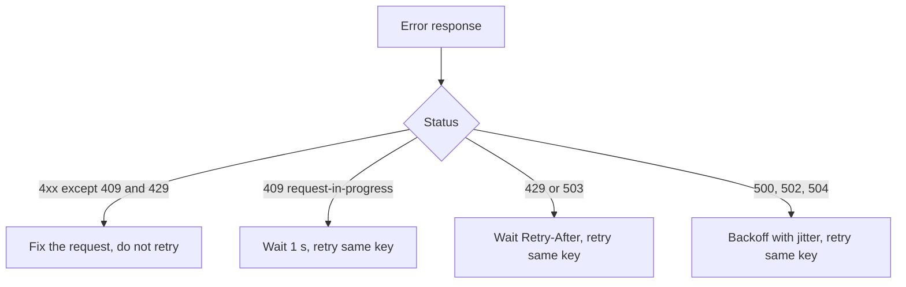

| Status | Stable |
| -- | -- |
| Version | 2.3 |
| Updated | 2026-05-18 |
| Owner | DemoJudy |
| Applies to | Every error response of the public API v2 |

## Overview

Errors are Problem Details for HTTP APIs (RFC 9457), served as `application/problem+json` ([RFC-039](@RFC-039)). Clients should branch on `type`, never on `title` or `detail`, which may change. Every error carries a `request_id`; quote it when contacting support.

## Shape

```json
{
  "type": "https://api.example.com/problems/insufficient-scope",
  "title": "The token lacks a required scope",
  "status": 403,
  "detail": "This endpoint needs the scope refunds:write",
  "instance": "/v2/refunds",
  "request_id": "req_01JCV8E1TQ",
  "required_scope": "refunds:write"
}
```

| Member | Type | Always present | Notes |
| -- | -- | -- | -- |
| `type` | URI | yes | Stable; one page per type in the reference |
| `title` | string | yes | Short summary in English |
| `status` | integer | yes | Same as the HTTP status |
| `detail` | string | no | This occurrence, in English |
| `instance` | string | yes | Request path |
| `request_id` | string | yes | Also in the `X-Request-Id` header |
| `errors` | array | for `validation-failed` | `field`, `code` and rule parameters |

Some types add members, listed below.

## Problem types

| Type | Status | Extra members | Retry? |
| -- | -- | -- | -- |
| `validation-failed` | 422 | `errors` | no, fix the request |
| `invalid-json` | 400 | `line`, `column` | no |
| `not-found` | 404 | | no |
| `conflict` | 409 | `current_version` | after re-reading the resource |
| `insufficient-scope` | 403 | `required_scope` | no |
| `token-expired` | 401 | | after getting a new token |
| `rate-limited` | 429 | `retry_after` | yes, after `Retry-After` |
| `idempotency-key-required` | 400 | | no |
| `idempotency-key-reused` | 422 | | no, use a new key |
| `request-in-progress` | 409 | | yes, after 1 second |
| `cursor-expired` | 400 | | restart the list |
| `version-retired` | 410 | `sunset` | no |
| `internal-error` | 500 | | yes, with backoff |
| `service-unavailable` | 503 | | yes, after `Retry-After` |

## Validation codes

| Code | Meaning | Parameters |
| -- | -- | -- |
| `required` | Field is missing | |
| `too_long` | String longer than allowed | `max_length` |
| `must_be_positive` | Number is zero or negative | |
| `invalid_enum` | Value not in the list | `allowed` |
| `invalid_currency` | Not an ISO 4217 code we support | |
| `unknown_reference` | Id does not exist or belongs to another seller | |

## Retry guidance



Always retry with the same `Idempotency-Key` ([SPEC-035](@SPEC-035)). The SDKs follow this table ([SPEC-044](@SPEC-044)).

## Version history

| Version | Date | Change |
| -- | -- | -- |
| 2.0 | 2025-11-18 | Problem details for all v2 endpoints |
| 2.1 | 2026-01-13 | `cursor-expired` |
| 2.2 | 2026-04-21 | `retry_after` member on `rate-limited` |
| 2.3 | 2026-05-18 | `version-retired` for v1 brownouts |
