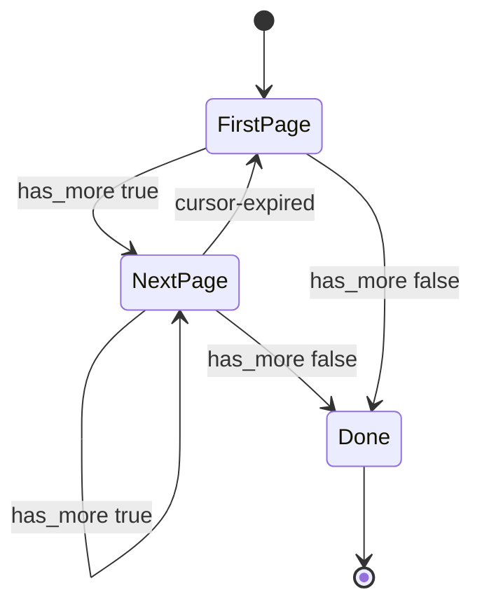

| Status | Stable |
| -- | -- |
| Version | 2.1 |
| Updated | 2026-01-13 |
| Owner | DemoJudy |
| Applies to | Every list endpoint of the public API v2 |

## Overview

Lists are paged with opaque cursors ([RFC-032](@RFC-032)). A response gives the cursor of the next page; the client sends it back to get that page. Every page costs the server the same, however deep the client reads ([RN-031](@RN-031)).

## Parameters

| Parameter | Type | Default | Notes |
| -- | -- | -- | -- |
| `limit` | integer | 50 | 1 to 200 |
| `cursor` | string | none | From the previous response's `next_cursor` |
| filters | per endpoint | none | Must be the same on every page of one scan |

## Response

| Field | Type | Notes |
| -- | -- | -- |
| `data` | array | The items of this page, in the endpoint's sort order |
| `next_cursor` | string or null | Null on the last page |
| `has_more` | boolean | False on the last page |

```http
GET /v2/orders?status=paid&limit=100 HTTP/1.1
Host: api.example.com
Authorization: Bearer dm_test_8f2c41
```

```json
{
  "data": [ { "id": "ord_01JA0T6Z", "status": "paid" } ],
  "next_cursor": "eyJ0IjoiMjAyNi0wMS0xM1QxMDowMDowMFoiLCJpZCI6Im9yZF8wMUpBMFQ2WiIsImYiOiI4YzQyIn0",
  "has_more": true
}
```

## Sort orders

| Endpoint | Sort order | Stable under inserts |
| -- | -- | -- |
| `GET /products` | `updated_at`, then `id`, ascending | yes |
| `GET /inventory` | `variant_id` ascending | yes |
| `GET /orders` | `created_at`, then `id`, descending | yes |
| `GET /webhook-subscriptions/{id}/deliveries` | `attempted_at` descending | yes |

Because products sort by `updated_at`, a scan that starts at a stored cursor returns every product changed since that cursor: partners use this for incremental catalog reads.

## Cursor rules

* Cursors are opaque. Do not build or change them; their content may change without notice.
* A cursor is valid for 24 hours. After that the request fails with `cursor-expired` ([SPEC-032](@SPEC-032)).
* A cursor is bound to its filters. Changing a filter mid-scan fails with `validation-failed` on `cursor`.

## Reading everything

```python
from demomart import DemoMart

client = DemoMart(client_id="dm_test_client_7Q2", client_secret=secret)

count = 0
for product in client.products.list(limit=200):
    count += 1
print(f"{count} products")
```

The SDK iterator follows `next_cursor` until `has_more` is false ([SPEC-044](@SPEC-044)).



## Version history

| Version | Date | Change |
| -- | -- | -- |
| 2.0 | 2025-11-18 | Cursor pagination for all v2 lists |
| 2.1 | 2026-01-13 | Cursors bound to filters; `cursor-expired` problem type |
