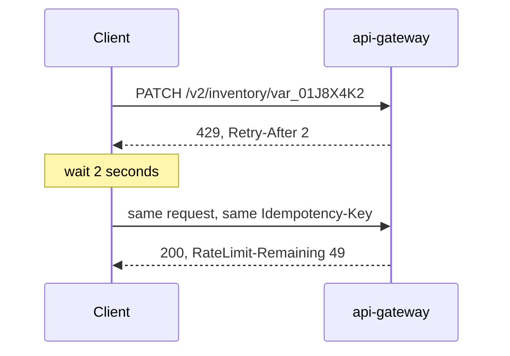

| Status | Stable |
| -- | -- |
| Version | 2.0 |
| Updated | 2026-04-21 |
| Owner | DemoNina |
| Applies to | Every response of the public API v2 |

## Overview

The API limits requests per partner and endpoint class with token buckets ([ADR-034](@ADR-034), [RFC-033](@RFC-033)). Every response tells the client how much of its budget is left, using the `RateLimit` header fields of the IETF draft, so clients can slow down before they are refused.

## Limits

| Class | Endpoints | Rate | Burst |
| -- | -- | -- | -- |
| `read` | `GET` on products, inventory, orders | 20 per second | 200 |
| `write` | `POST`, `PATCH`, `DELETE` on products and inventory | 10 per second | 50 |
| `order-actions` | Confirmations, shipments, refunds | 10 per second | 20 |
| `bulk` | `POST /import-jobs` | 1 per 10 seconds | 3 |
| `token` | `POST /oauth/token` | 30 per minute per app | 30 |

Limits apply per partner, across all of the partner's apps. Higher limits can be requested in the partner portal.

## Headers

| Header | Example | Meaning |
| -- | -- | -- |
| `RateLimit-Policy` | `"read";q=200;w=10` | The bucket size and the seconds to refill it fully |
| `RateLimit-Limit` | `200` | Bucket size of the class this request used |
| `RateLimit-Remaining` | `143` | Tokens left after this request |
| `RateLimit-Reset` | `3` | Seconds until the bucket is full again |
| `Retry-After` | `2` | Only on `429`: seconds to wait before retrying |

```http
HTTP/1.1 200 OK
Content-Type: application/json
RateLimit-Policy: "read";q=200;w=10
RateLimit-Limit: 200
RateLimit-Remaining: 143
RateLimit-Reset: 3
```

```http
HTTP/1.1 429 Too Many Requests
Content-Type: application/problem+json
Retry-After: 2
RateLimit-Limit: 50
RateLimit-Remaining: 0
RateLimit-Reset: 5

{
  "type": "https://api.example.com/problems/rate-limited",
  "title": "Too many requests",
  "status": 429,
  "instance": "/v2/products/prd_01J8X4K2",
  "request_id": "req_01JCVA0P4N",
  "retry_after": 2
}
```

## Client behaviour

1. On `429`, wait `Retry-After` seconds, then retry the same request with the same `Idempotency-Key` ([SPEC-035](@SPEC-035)).
2. When `RateLimit-Remaining` falls under 10 % of `RateLimit-Limit`, spread the next requests over `RateLimit-Reset` seconds.
3. Never retry in a tight loop; repeated `429` responses within one second are counted against the next window.



For many writes, use import jobs instead of single calls ([SPEC-041](@SPEC-041)).

## Version history

| Version | Date | Change |
| -- | -- | -- |
| 1.0 | 2025-11-18 | `X-RateLimit-Remaining` on `429` responses only |
| 2.0 | 2026-04-21 | `RateLimit` fields on every response; classes per endpoint |
