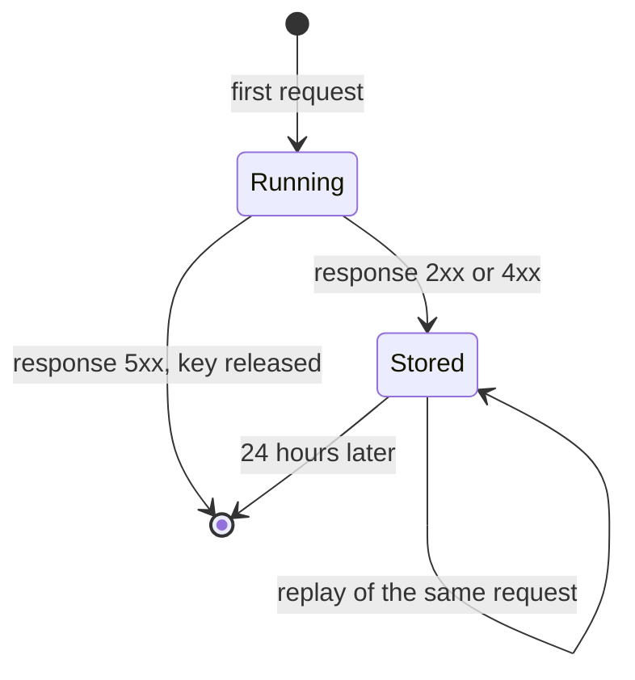

| Status | Stable |
| -- | -- |
| Version | 2.0 |
| Updated | 2025-11-18 |
| Owner | DemoErin |
| Applies to | Every `POST` and `PATCH` of the public API v2 |

## Overview

Every mutating request carries an `Idempotency-Key` header ([ADR-019](@ADR-019), [RFC-034](@RFC-034)). The first request with a key is processed; a retry with the same key and body gets the stored response instead of a second action. This makes it safe to retry after a timeout, a dropped connection or a `5xx`.

## The header

| Rule | Value |
| -- | -- |
| Header | `Idempotency-Key` |
| Required on | `POST` and `PATCH`; ignored on `GET` and `DELETE` (which are idempotent by definition) |
| Format | 1 to 255 printable ASCII characters; a UUID is recommended |
| Scope | Per partner: two partners may use the same key independently |
| Lifetime | 24 hours after the first request finished |

```http
POST /v2/orders/ord_01JA0T6Z/shipments HTTP/1.1
Host: api.example.com
Authorization: Bearer dm_test_8f2c41
Idempotency-Key: 8e3b2f60-4c1d-4a9e-b7f2-6d5c4b3a2190
Content-Type: application/json

{ "carrier": "demo-post", "tracking_number": "DP123456789", "items": [ { "line_id": "lin_01", "quantity": 1 } ] }
```

## Outcomes

| Situation | Status | Body | Header |
| -- | -- | -- | -- |
| New key | as processed | as processed | |
| Same key and body, first request finished | stored status | stored body | `Idempotent-Replayed: true` |
| Same key and body, first request still running | `409` | `request-in-progress` | `Retry-After: 1` |
| Same key, different body | `422` | `idempotency-key-reused` | |
| Missing key | `400` | `idempotency-key-required` | |
| First request ended with `5xx` | as processed again | | |

The body comparison uses a SHA-256 of the raw request body, so whitespace changes count as a different body. Send the same bytes when you retry.

## Lifecycle of a key



## Storage

Keys live in Redis next to `api-gateway`, under `idem:<partner>:<key>`. A record holds the body hash, the status, the response headers that matter (`Location`, `Content-Type`) and the response body, up to 256 KB. Responses larger than that are not stored; the retry then gets `409` with `request-in-progress` for the first request's duration and is processed again afterwards, which the services make safe with their own unique constraints.

## Measured effect

Duplicate refunds fell from 41 in July 2025 to none after keys became required ([RN-037](@RN-037)). Replays make up 0.27 % of mutating calls.

## Version history

| Version | Date | Change |
| -- | -- | -- |
| 1.0 | 2025-09-02 | Optional header in the v2 beta |
| 2.0 | 2025-11-18 | Required on all mutating calls |
