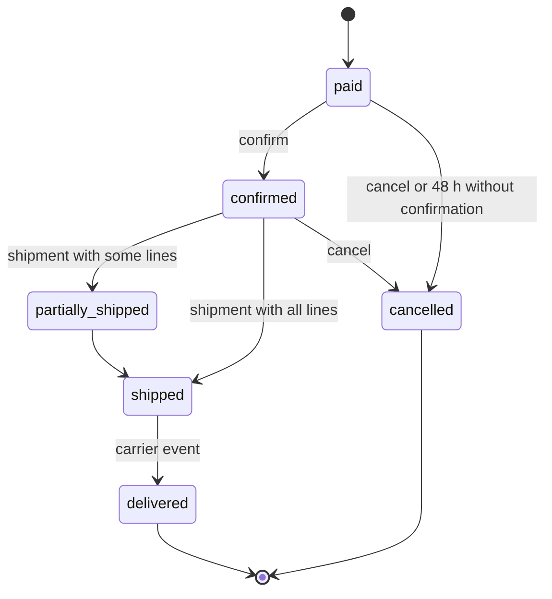

| Status | Stable |
| -- | -- |
| Version | 2.6 |
| Updated | 2026-08-25 |
| Owner | DemoErin |
| Applies to | `/v2/orders`, shipments and refunds |

## Overview

An order is created when a buyer pays at checkout ([SPEC-045](@SPEC-045)). The seller's partner system then confirms it, ships it in one or more shipments and, if needed, refunds it. The order's state lives in `orders-svc` ([ADR-021](@ADR-021)); its full state machine is in [SPEC-047](@SPEC-047).

## Endpoints

| Method | Path | Scope | Notes |
| -- | -- | -- | -- |
| `GET` | `/orders` | `orders:read` | Filters `status`, `created_since`, `updated_since` |
| `GET` | `/orders/{order_id}` | `orders:read` | Lines, totals, shipping address, shipments |
| `POST` | `/orders/{order_id}/confirm` | `orders:write` | Seller accepts the order; within 48 hours of payment |
| `POST` | `/orders/{order_id}/cancel` | `orders:write` | Only before the first shipment; refunds in full |
| `POST` | `/orders/{order_id}/shipments` | `orders:write` | Ships some or all lines |
| `GET` | `/orders/{order_id}/shipments` | `orders:read` | |
| `POST` | `/refunds` | `refunds:write` | Full or partial ([SPEC-050](@SPEC-050)) |

## States visible to partners



Refunds do not change the order state; they appear in `refunds` with their own status.

## Order fields

| Field | Type | Notes |
| -- | -- | -- |
| `id` | string | `ord_` prefix |
| `status` | enum | As in the diagram |
| `lines` | array | `line_id`, `variant_id`, `sku`, `quantity`, `unit_price`, `tax` |
| `totals` | object | `items`, `shipping`, `tax`, `discount`, `total`, all money |
| `shipping_address` | object | Only after confirmation; removed 90 days after delivery ([ADR-028](@ADR-028)) |
| `shipping_option` | object | Chosen at checkout ([SPEC-051](@SPEC-051)) |
| `estimated_delivery` | date | From version 2.6 |
| `shipments` | array | `id`, `carrier`, `tracking_number`, `lines`, `shipped_at` |
| `created_at`, `updated_at` | timestamp | |

The buyer's name appears only in the shipping address and only while the seller needs it to ship.

## Ship an order

```sh
curl -X POST https://api.example.com/v2/orders/ord_01JA0T6Z/shipments \
  -H "Authorization: Bearer $TOKEN" \
  -H "Idempotency-Key: 3c2b1a09-8f7e-4d6c-9b5a-4e3d2c1b0a9f" \
  -H "Content-Type: application/json" \
  -d '{ "carrier": "demo-post", "tracking_number": "DP123456789", "items": [ { "line_id": "lin_01", "quantity": 2 } ] }'
```

```json
{
  "id": "shp_01JD4Q8N",
  "order_id": "ord_01JA0T6Z",
  "carrier": "demo-post",
  "tracking_number": "DP123456789",
  "items": [ { "line_id": "lin_01", "quantity": 2 } ],
  "shipped_at": "2026-08-25T13:40:11Z"
}
```

## Errors specific to orders

| Status | Problem type | When |
| -- | -- | -- |
| `409` | `invalid-state-transition` | For example confirming a cancelled order; `current_status` is included |
| `422` | `quantity-exceeds-remaining` | Shipping more of a line than is left to ship |
| `422` | `refund-exceeds-captured` | Refunding more than was paid |

## Version history

| Version | Date | Change |
| -- | -- | -- |
| 2.0 | 2025-11-18 | Orders, shipments, refunds in v2 |
| 2.3 | 2026-03-03 | Automatic cancellation after 48 hours without confirmation |
| 2.6 | 2026-08-25 | `estimated_delivery` |
