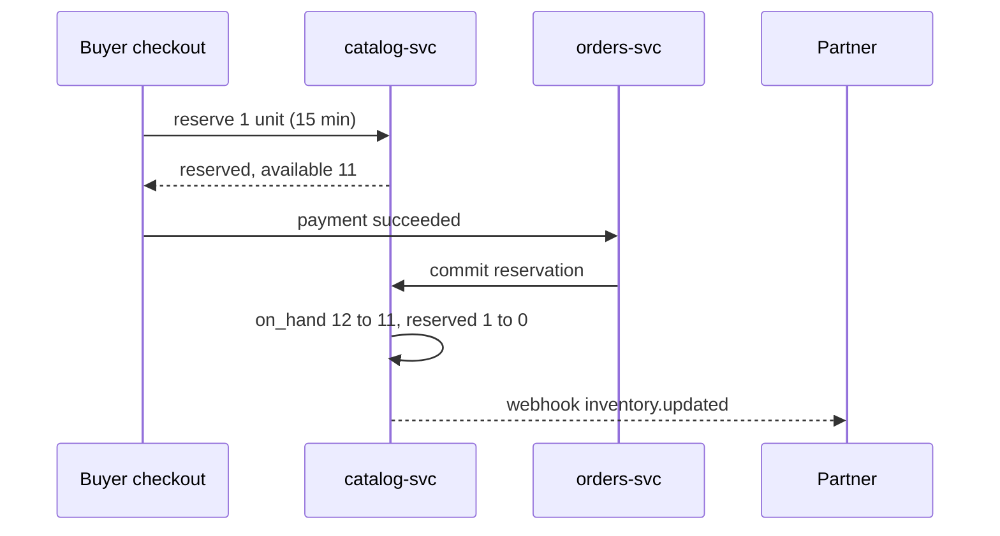

| Status | Stable |
| -- | -- |
| Version | 2.2 |
| Updated | 2026-03-17 |
| Owner | DemoFrank |
| Applies to | `/v2/inventory` |

## Overview

Inventory is the number of units of a variant a seller can sell now. Checkout reserves units when a buyer starts paying ([SPEC-054](@SPEC-054)), so the API distinguishes what the seller has on hand from what is still available to sell. Sellers who keep stock in their own system push changes here, one variant at a time or as an import job ([SPEC-041](@SPEC-041)); the protocol for continuous sync from seller systems is [SPEC-080](@SPEC-080).

## Endpoints

| Method | Path | Scope | Notes |
| -- | -- | -- | -- |
| `GET` | `/inventory` | `inventory:read` | Cursor-paged; filter `variant_ids` (up to 100), `updated_since` |
| `GET` | `/inventory/{variant_id}` | `inventory:read` | |
| `PATCH` | `/inventory/{variant_id}` | `inventory:write` | Set or adjust stock |

## Fields

| Field | Type | Notes |
| -- | -- | -- |
| `variant_id` | string | `var_` prefix |
| `on_hand` | integer | Units the seller has, as last reported |
| `reserved` | integer | Read-only: units held by checkouts in progress, for at most 15 minutes |
| `available` | integer | Read-only: `on_hand` minus `reserved`, never below 0 |
| `updated_at` | timestamp | Last change of `on_hand` |
| `sequence` | integer | Read-only; increases with every change |

## Set or adjust

Two ways to change stock, never both in one request:

| Body | Effect | Use when |
| -- | -- | -- |
| `{ "on_hand": 12 }` | Sets the absolute value | You have a full count from your warehouse |
| `{ "adjust_by": -2, "reason": "damaged" }` | Adds or removes units | You record movements |

```http
PATCH /v2/inventory/var_01J8X4K2 HTTP/1.1
Host: api.example.com
Authorization: Bearer dm_test_8f2c41
Idempotency-Key: 2b3c4d5e-6f70-4812-9a3b-4c5d6e7f8091
Content-Type: application/json

{ "on_hand": 12, "if_sequence": 418 }
```

```json
{
  "variant_id": "var_01J8X4K2",
  "on_hand": 12,
  "reserved": 1,
  "available": 11,
  "sequence": 419,
  "updated_at": "2026-03-17T10:02:45Z"
}
```

`if_sequence` is optional. With it, the change applies only if nothing else changed the variant since, otherwise `409 conflict`. Use it when two systems write the same variant.

## How a sale changes stock



When `available` reaches 0, the variant is shown as sold out within seconds ([ADR-036](@ADR-036)).

## Limits

Stock updates count against the `write` class: 10 per second, burst 50 ([SPEC-034](@SPEC-034)). For more than a few hundred changes at once, use an import job: it processes about 480 rows per second ([RN-034](@RN-034)).

## Version history

| Version | Date | Change |
| -- | -- | -- |
| 2.0 | 2025-11-18 | `on_hand`, `reserved`, `available` |
| 2.1 | 2026-01-13 | `adjust_by` with reasons |
| 2.2 | 2026-03-17 | `if_sequence` for conditional updates |
