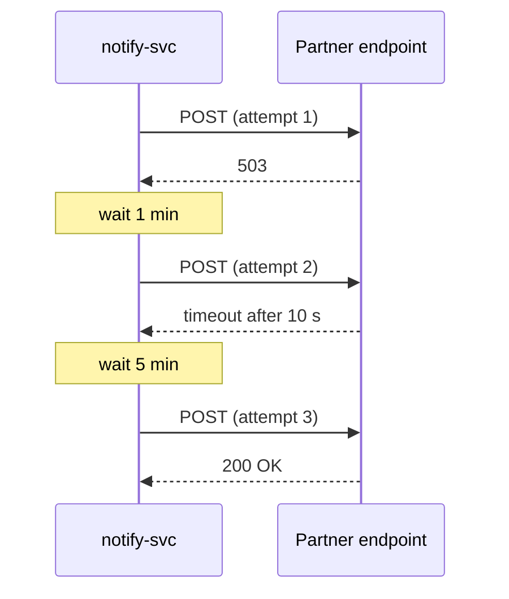

| Status | Stable |
| -- | -- |
| Version | 2.1 |
| Updated | 2026-02-24 |
| Owner | DemoFrank |
| Applies to | Every webhook DemoMart sends to partners |

## Overview

Webhooks tell partner systems about changes as they happen ([RFC-031](@RFC-031)). `notify-svc` sends each matching event as an HTTPS `POST` to the subscription's URL, signs it ([ADR-018](@ADR-018)) and retries failures for 72 hours. The event types are listed in [SPEC-040](@SPEC-040).

## Subscriptions

| Method | Path | Scope |
| -- | -- | -- |
| `POST` | `/webhook-subscriptions` | `webhooks:manage` |
| `GET` | `/webhook-subscriptions` | `webhooks:manage` |
| `DELETE` | `/webhook-subscriptions/{id}` | `webhooks:manage` |
| `POST` | `/webhook-subscriptions/{id}/rotate-secret` | `webhooks:manage` |
| `GET` | `/webhook-subscriptions/{id}/deliveries` | `webhooks:manage` |

```json
{
  "url": "https://partner.example.com/hooks/demomart",
  "event_types": ["order.paid", "order.cancelled", "inventory.updated"]
}
```

The URL must use HTTPS on port 443 and resolve to a public address. The response contains the signing secret, `whsec_...`, shown only once.

## The request

```http
POST /hooks/demomart HTTP/1.1
Host: partner.example.com
Content-Type: application/json
User-Agent: DemoMart-Webhooks/2
DemoMart-Webhook-Id: whk_01JE2B6C7D
DemoMart-Webhook-Timestamp: 1772960400
DemoMart-Webhook-Signature: v1=3a7bd3e2360a3d29eea436fcfb7e44c735d117c42d1c1835420b6b9942dd4f1b

{"id":"evt_01JE2B6B9X","type":"order.paid","created_at":"2026-03-08T09:00:00Z","data":{"order_id":"ord_01JE2A0Z","total":{"amount":5998,"currency":"EUR"}}}
```

## Verifying the signature

1. Read the timestamp and reject it if it is more than 5 minutes from your clock.
2. Compute HMAC-SHA256 with the subscription secret over `<timestamp>.<raw body>`, hex-encoded.
3. Compare it in constant time with each `v1=` value in the signature header; during rotation there are two.

```go
func Verify(secret []byte, timestamp, body, header string) bool {
	mac := hmac.New(sha256.New, secret)
	mac.Write([]byte(timestamp + "." + body))
	want := hex.EncodeToString(mac.Sum(nil))
	for _, part := range strings.Split(header, ",") {
		got := strings.TrimPrefix(strings.TrimSpace(part), "v1=")
		if hmac.Equal([]byte(got), []byte(want)) {
			return true
		}
	}
	return false
}
```

Use the raw body as received; parsing and re-serialising JSON changes the bytes. The SDKs include this check ([SPEC-044](@SPEC-044)).

## Delivery and retries



| Rule | Value |
| -- | -- |
| Success | Any `2xx` within 10 seconds |
| Retry schedule | 1 min, 5 min, 30 min, 2 h, 6 h, 12 h, then every 12 h |
| Give up | 72 hours after the first attempt |
| Order | In event order per subject (one order, one variant) |
| Duplicates | Possible; deduplicate on `DemoMart-Webhook-Id` |
| Pause | After 5 days in which every delivery failed |

Answer quickly and do the work afterwards: deliveries that take over 10 seconds count as failures. Delivery success and retry timing are measured in [RN-030](@RN-030).

## Version history

| Version | Date | Change |
| -- | -- | -- |
| 2.0 | 2025-11-18 | Signed deliveries from `notify-svc` |
| 2.1 | 2026-02-24 | Two signatures during secret rotation |
