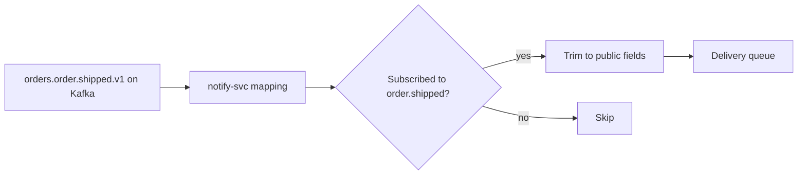

| Status | Stable |
| -- | -- |
| Version | 2.3 |
| Updated | 2026-08-25 |
| Owner | DemoFrank |
| Applies to | The `type` and `data` of every webhook |

## Overview

Each webhook carries one event. The event types are a public view of DemoMart's domain events ([SPEC-016](@SPEC-016)): `notify-svc` maps an internal type such as `orders.order.confirmed.v1` to a public type such as `order.confirmed` and keeps only the fields partners may see. How events are delivered is in [SPEC-039](@SPEC-039).

## Common envelope

| Field | Type | Notes |
| -- | -- | -- |
| `id` | string | `evt_` prefix; the same across retries and replays |
| `type` | string | One of the types below |
| `created_at` | timestamp | When the change happened |
| `api_version` | string | Shape of `data`, for example `2026-08-25` |
| `data` | object | The changed resource, trimmed to the fields below |

## Types

| Type | Sent when | `data` fields |
| -- | -- | -- |
| `order.paid` | A buyer paid; the order waits for confirmation | `order_id`, `lines`, `total`, `confirm_by` |
| `order.confirmed` | The seller confirmed | `order_id` |
| `order.cancelled` | Cancelled by seller, buyer or timeout | `order_id`, `reason` |
| `order.shipped` | A shipment was created | `order_id`, `shipment_id`, `carrier`, `tracking_number` |
| `order.delivered` | The carrier reported delivery | `order_id`, `shipment_id`, `delivered_at` |
| `refund.created` | A refund started | `refund_id`, `order_id`, `amount` |
| `refund.succeeded` | The money went back to the buyer | `refund_id`, `order_id` |
| `refund.failed` | The payment processor refused the refund | `refund_id`, `order_id`, `failure_code` |
| `product.updated` | Any change to a product or its variants | `product_id`, `changed_fields`, `version` |
| `product.archived` | A product was archived | `product_id` |
| `inventory.updated` | `on_hand` or `available` changed | `variant_id`, `on_hand`, `available`, `sequence` |
| `import_job.finished` | An import job ended ([SPEC-041](@SPEC-041)) | `job_id`, `status`, `rows_ok`, `rows_failed` |

## Example

```json
{
  "id": "evt_01JE8P2M4Q",
  "type": "order.shipped",
  "created_at": "2026-08-25T13:40:12Z",
  "api_version": "2026-08-25",
  "data": {
    "order_id": "ord_01JA0T6Z",
    "shipment_id": "shp_01JD4Q8N",
    "carrier": "demo-post",
    "tracking_number": "DP123456789"
  }
}
```

## Thin events

Events carry ids and the fields that changed, not the full resource. A partner that needs more reads the resource through the API. This keeps payloads small (median 412 bytes) and means a delayed retry never delivers stale details as if they were current.

## From domain event to webhook



## Adding a type

New types are additive: subscriptions receive only the types they list, so a new type never reaches an existing endpoint unasked. A new field in `data` is also additive; partners must ignore unknown fields. Removing a field follows the deprecation policy ([RFC-037](@RFC-037)).

## Version history

| Version | Date | Change |
| -- | -- | -- |
| 2.0 | 2025-11-18 | Order, refund, product and inventory events |
| 2.1 | 2026-01-13 | `import_job.finished` |
| 2.2 | 2026-03-03 | `confirm_by` on `order.paid` |
| 2.3 | 2026-08-25 | `api_version` in the envelope |
