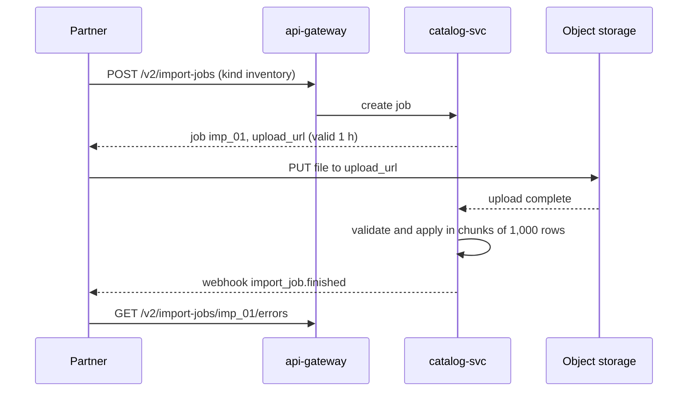

| Status | Stable |
| -- | -- |
| Version | 1.2 |
| Updated | 2026-05-05 |
| Owner | DemoIvan |
| Applies to | `/v2/import-jobs` |

## Overview

An import job applies many product, price or stock changes from one file, asynchronously. It replaces thousands of single calls and was chosen over synchronous batch endpoints ([RFC-038](@RFC-038)). The partner uploads a file, the job runs in `catalog-svc` workers, and the partner reads one error report at the end.

## Endpoints

| Method | Path | Scope | Notes |
| -- | -- | -- | -- |
| `POST` | `/import-jobs` | `inventory:write` or `products:write` | Creates a job and returns an upload URL |
| `GET` | `/import-jobs/{job_id}` | same | Status and counts |
| `GET` | `/import-jobs/{job_id}/errors` | same | CSV with one line per failed row |
| `POST` | `/import-jobs/{job_id}/cancel` | same | Stops a queued or running job |

## Job kinds and file columns

| Kind | Columns | Scope |
| -- | -- | -- |
| `inventory` | `sku`, `on_hand` | `inventory:write` |
| `prices` | `sku`, `price_amount`, `currency`, `compare_at_amount` | `products:write` |
| `products` | `sku`, `title`, `category_id`, `status`, `price_amount`, `currency`, `weight_grams` | `products:write` |

Files are CSV (UTF-8, comma, header row) or JSON Lines, up to 200 MB or 1,000,000 rows, optionally gzip-compressed.

## Flow



```http
POST /v2/import-jobs HTTP/1.1
Host: api.example.com
Authorization: Bearer dm_test_8f2c41
Idempotency-Key: 7d6c5b4a-3928-4170-8f6e-5d4c3b2a1908
Content-Type: application/json

{ "kind": "inventory", "format": "csv", "compression": "gzip" }
```

```json
{
  "id": "imp_01JF0G3K",
  "status": "awaiting_upload",
  "upload_url": "https://uploads.example.com/imp_01JF0G3K?signature=...",
  "upload_expires_at": "2026-05-05T11:00:00Z"
}
```

## Status

| Status | Meaning |
| -- | -- |
| `awaiting_upload` | Created; no file yet |
| `queued` | File received; waiting for a worker |
| `running` | Rows being applied; `rows_done` grows |
| `succeeded` | Every row applied |
| `partially_succeeded` | Some rows failed; see the error report |
| `failed` | The file could not be read; nothing applied |
| `cancelled` | Stopped by the partner |

Rows are applied in file order within a job; jobs of one partner run one at a time per kind, so a later stock file never overtakes an earlier one.

## Throughput

A job applies about 480 rows per second for inventory and 310 for full products ([RN-034](@RN-034)). Creating jobs is limited to 1 per 10 seconds per partner, burst 3 ([SPEC-034](@SPEC-034)).

## Version history

| Version | Date | Change |
| -- | -- | -- |
| 1.0 | 2026-01-13 | Inventory and price imports |
| 1.1 | 2026-03-03 | Full product imports |
| 1.2 | 2026-05-05 | JSON Lines and gzip |
