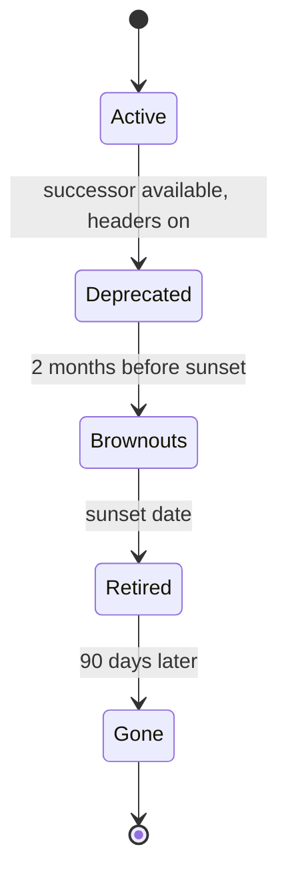

| Status | Stable |
| -- | -- |
| Version | 1.1 |
| Updated | 2026-04-28 |
| Owner | DemoErin |
| Applies to | Versions, endpoints and fields of the public API |

## Overview

The major version is in the path, `/v2/` ([ADR-016](@ADR-016)). Within a major version, changes are additive; anything else follows the deprecation policy ([RFC-037](@RFC-037)): announced, signalled in headers, and retired no sooner than 12 months after its successor is available.

## What is a breaking change

| Change | Breaking? |
| -- | -- |
| New endpoint, new optional request field, new response field | no |
| New value in a response enum | no, but clients must tolerate unknown values |
| New webhook event type | no, subscriptions list their types |
| Removed endpoint, field or enum value | yes |
| A request field becomes required | yes |
| A field changes type or meaning | yes |
| Stricter validation of existing input | yes |

## Headers on deprecated endpoints

| Header | Example | Meaning |
| -- | -- | -- |
| `Deprecation` | `Mon, 05 Jan 2026 00:00:00 GMT` | When it was deprecated |
| `Sunset` | `Tue, 30 Jun 2026 00:00:00 GMT` | When it stops working (RFC 8594) |
| `Link` | `<https://api.example.com/docs/migrate-v1>; rel="deprecation"` | The migration guide |

```http
HTTP/1.1 200 OK
Content-Type: application/json
Deprecation: Mon, 05 Jan 2026 00:00:00 GMT
Sunset: Tue, 30 Jun 2026 00:00:00 GMT
Link: <https://api.example.com/docs/migrate-v1>; rel="deprecation"
```

Deprecated fields are marked `deprecated: true` in the OpenAPI document with an `x-sunset` date. The generated changelog lists them ([RFC-041](@RFC-041)), and the SDKs log a warning once per process when a deprecated field is used ([SPEC-044](@SPEC-044)).

## After the sunset

| Period | Response |
| -- | -- |
| Brownout windows before the sunset | `410` with problem type `version-retired` |
| 0 to 90 days after the sunset | `410` with `version-retired` and the `sunset` member |
| After 90 days | `404` |

## Life of a deprecated endpoint



## Version 1 retirement

| Date | Event |
| -- | -- |
| 2026-01-05 | `Deprecation` and `Sunset` on every v1 response |
| 2026-05-12 | Brownout, 1 hour |
| 2026-06-02 | Brownout, 4 hours |
| 2026-06-30 | Retired ([ADR-044](@ADR-044)) |
| 2026-09-28 | `404` instead of `410` |

Progress of the migration is in [RN-038](@RN-038).

## Version history

| Version | Date | Change |
| -- | -- | -- |
| 1.0 | 2026-01-05 | Headers and breaking-change rules |
| 1.1 | 2026-04-28 | Brownout behaviour |
