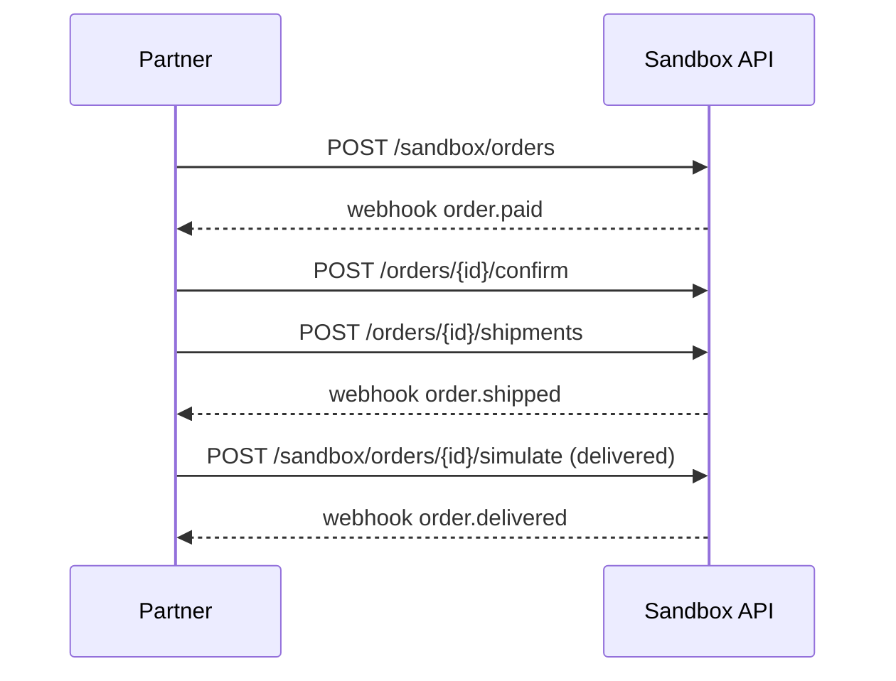

| Status | Draft |
| -- | -- |
| Version | 0.9 |
| Updated | 2026-07-14 |
| Owner | DemoNina |
| Applies to | `https://sandbox.api.example.com/v2` |

## Overview

The sandbox is a full copy of the public API for building and testing integrations without real orders or money ([RFC-036](@RFC-036)). It runs the same code and the same OpenAPI document as production, with synthetic data, payment test mode and simulated carriers.

## Differences from production

| Aspect | Production | Sandbox |
| -- | -- | -- |
| Host | `api.example.com` | `sandbox.api.example.com` |
| Keys | `dm_live_...` | `dm_test_...` |
| Data | Real sellers and orders | 200 products, 50 orders, 3 test sellers per partner |
| Payments | Real authorisation and capture | Processor test mode; no money moves |
| Carriers | Real tracking events | Simulated; states on demand |
| Webhooks | To the subscription URL | To the subscription URL, marked `"livemode": false` |
| Rate limits | As in [SPEC-034](@SPEC-034) | The same |
| Data lifetime | Indefinite | Reset on request; deleted after 90 days unused |

## Simulation endpoints

Only in the sandbox:

| Method | Path | Effect |
| -- | -- | -- |
| `POST` | `/sandbox/orders` | Creates a paid order for one of the test sellers |
| `POST` | `/sandbox/orders/{order_id}/simulate` | Moves the order to `to_state` and fires the webhooks on the way |
| `POST` | `/sandbox/refunds/{refund_id}/simulate` | Ends a refund as `succeeded` or `failed` |
| `POST` | `/sandbox/reset` | Restores the initial synthetic data |

```sh
curl -X POST https://sandbox.api.example.com/v2/sandbox/orders \
  -H "Authorization: Bearer $TOKEN" \
  -H "Idempotency-Key: 6a5b4c3d-2e1f-4091-8a7b-6c5d4e3f2a10" \
  -H "Content-Type: application/json" \
  -d '{ "lines": [ { "sku": "TEST-MUG-01", "quantity": 2 } ], "payment_outcome": "success" }'
```

## Test payment outcomes

| `payment_outcome` | Result |
| -- | -- |
| `success` | Paid at once |
| `soft_decline` | Declined, succeeds on the second retry ([RFC-050](@RFC-050)) |
| `challenge` | 3-D Secure challenge, then paid ([RFC-049](@RFC-049)) |
| `hard_decline` | Declined; no order is created |

## Simulated order lifecycle



## Open items

- [X] Synthetic data per partner
- [X] Payment test mode
- [ ] Simulation endpoints for orders and refunds
- [ ] Reset endpoint
- [ ] Decide whether sandbox limits stay equal to production

## Version history

| Version | Date | Change |
| -- | -- | -- |
| 0.5 | 2026-02-17 | Hosts, keys and data |
| 0.9 | 2026-07-14 | Simulation endpoints and payment outcomes |
