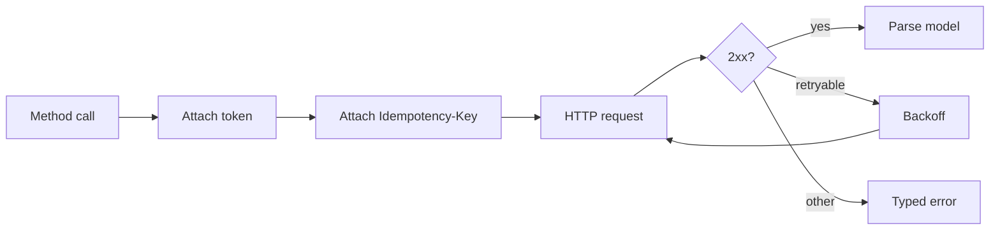

| Status | Stable |
| -- | -- |
| Version | 2.2 |
| Updated | 2026-06-09 |
| Owner | DemoJudy |
| Applies to | The TypeScript, Python and Go SDKs for the public API v2 |

## Overview

The SDKs are generated from the OpenAPI document and wrapped in a thin layer that every language implements the same way ([RFC-035](@RFC-035)). This spec is that layer's contract. A partner switching languages should find the same behaviour under idiomatic names.

## Packages

| Language | Package | Minimum runtime | Current version |
| -- | -- | -- | -- |
| TypeScript | `demomart` on npm | Node.js 20 | 2.9.1 |
| Python | `demomart` on PyPI | Python 3.10 | 2.9.0 |
| Go | `example.com/demomart-go/v2` | Go 1.22 | 2.9.0 |

## Behaviour

| Concern | Rule |
| -- | -- |
| Tokens | Fetched on first use, refreshed 5 minutes before expiry, one refresh at a time ([SPEC-031](@SPEC-031)) |
| Idempotency | A UUIDv4 `Idempotency-Key` on every `POST` and `PATCH`, reused across retries of one call ([SPEC-035](@SPEC-035)) |
| Retries | Up to 4 on `429`, `502`, `503`, `504`, connection resets and timeouts |
| Backoff | `Retry-After` if present, else 0.5 s times 2 to the attempt, with full jitter, at most 20 s |
| Timeouts | 30 s per request, configurable |
| Pagination | Iterators that follow `next_cursor` ([SPEC-033](@SPEC-033)) |
| Errors | One exception or error type per problem type, with `request_id` ([SPEC-032](@SPEC-032)) |
| Unknown values | Unknown enum values and fields are kept, never rejected |
| Webhooks | `verify_webhook(secret, headers, raw_body)` in constant time ([SPEC-039](@SPEC-039)) |
| Deprecations | One warning per process for each deprecated field or endpoint used ([SPEC-042](@SPEC-042)) |
| Telemetry | None; the SDK sends nothing but the API calls |

## The same call in three languages

```typescript
const refund = await client.refunds.create({ order_id: "ord_01JA0T6Z", amount: { amount: 2499, currency: "EUR" }, reason: "damaged" });
```

```python
refund = client.refunds.create(order_id="ord_01JA0T6Z", amount={"amount": 2499, "currency": "EUR"}, reason="damaged")
```

```go
refund, err := client.Refunds.Create(ctx, demomart.RefundCreateParams{
	OrderID: "ord_01JA0T6Z",
	Amount:  demomart.Money{Amount: 2499, Currency: "EUR"},
	Reason:  demomart.RefundReasonDamaged,
})
```

## Handling errors

```python
from demomart.errors import InvalidStateTransition, RateLimited

try:
    client.orders.confirm("ord_01JA0T6Z")
except InvalidStateTransition as e:
    print(f"order is {e.current_status}; request {e.request_id}")
```

`RateLimited` is raised only after retries are used up.

## Call path inside an SDK



## Releases

* SDKs are regenerated on every API release; a minor SDK version per API minor version.
* Breaking changes in the hand-written layer need a new major SDK version, with 6 months of fixes for the previous one.
* Adoption by language is tracked in [RN-035](@RN-035).

## Version history

| Version | Date | Change |
| -- | -- | -- |
| 2.0 | 2026-01-20 | First shared contract for all three SDKs |
| 2.1 | 2026-04-21 | Honour `RateLimit` headers |
| 2.2 | 2026-06-09 | Deprecation warnings |
