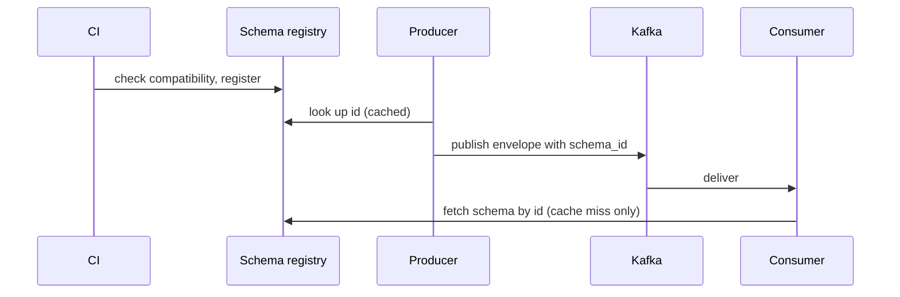

| Status | Implemented |
| -- | -- |
| Created | 2025-10-14 |
| Authors | DemoCarol |
| Reviewers | DemoIvan, DemoNina |
| Target | Q1 2026 |
| Decision | [ADR-026 Use Protobuf event payloads with a schema registry](@ADR-026) |

## Summary

Register every event payload schema in a schema registry, check each change for compatibility in CI, and put the schema id into the event envelope so consumers can always decode what they read.

## Motivation

Event payloads are Protobuf, but the `.proto` files live in each producer's repository folder and are copied by hand into consumers. Between July and September 2025:

* 7 consumer incidents came from a producer change the consumer did not expect; 3 of them were a renamed field that decoded as empty.
* Consumers held 4 different copies of `order_confirmed.proto`.
* Replaying a 90-day-old event failed twice because nobody had the schema it was written with.

## Proposal

### Registry

A Confluent-compatible schema registry runs next to Kafka in each region. Subjects follow the event type without its major version: `orders.order.confirmed`. Each major version of an event type is a separate subject.

### Compatibility rules

| Subject | Mode | Meaning |
| -- | -- | -- |
| Domain events | `FULL_TRANSITIVE` | New consumers read old events, old consumers read new events, across all versions |
| Change data capture | `BACKWARD` | New consumers read old events |
| Analytics events | `BACKWARD` | New consumers read old events |

A breaking change gets a new major version and a new subject; producers publish both for at least 30 days.

### CI check

```yaml
# .ci/schemas.yaml, run on every change under proto/events/
schema-check:
  image: registry.example.com/tools/buf:1.47
  script:
    - buf lint proto/events
    - buf breaking proto/events --against "https://schemas.example.com/subjects"
    - schemactl check --mode FULL_TRANSITIVE proto/events
```

### Envelope

The envelope's `schema_id` field ([SPEC-016](@SPEC-016)) carries the registry id. Consumers cache schemas by id; a cache miss costs one registry call.



## Alternatives

| Option | Catches breaking changes | Old events decodable | Why not |
| -- | -- | -- | -- |
| Shared Git repository of `.proto` files | at review only | if tags are kept | No runtime lookup by id |
| JSON with JSON Schema | yes | yes | Payloads 2.6 times larger ([RN-024](@RN-024)) |
| **Registry with Protobuf** | **in CI** | **always** | Chosen |

## Rollout

- [X] Registry in both regions, behind the internal load balancer
- [X] Import every existing `.proto` file as version 1
- [X] CI check on the events folder
- [X] `schema_id` in the envelope, version 1.2 of [SPEC-016](@SPEC-016)
- [X] Consumers decode by id instead of compiled-in copies

## Open questions

* How do we backfill events written before the registry existed? See [RFC-027](@RFC-027).
