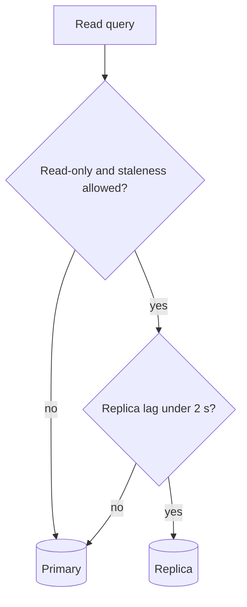

| Status | Draft |
| -- | -- |
| Created | 2026-10-06 |
| Authors | DemoKen |
| Reviewers | DemoGrace, DemoIvan |
| Target | Q1 2027 |
| Decision | open |

## Summary

Send `catalog-svc`'s read-only queries for product pages to two PostgreSQL read replicas, while writes and read-your-own-write paths stay on the primary.

## Motivation

* Product page reads peaked at 21,000 queries per second during the October 2026 sale, 88 % of all catalog queries.
* The primary ran at 81 % CPU at that peak; the planning limit is 70 %.
* The edge cache already serves product pages for 60 seconds ([ADR-035](@ADR-035)), so most reads can tolerate data a second old.

## Proposal

### Routing

`catalog-svc` gets two connection pools: `primary` and `replica`. A query goes to the replica only if it is marked read-only and its caller accepts staleness.

```go
// Product pages accept up to 2 s of staleness.
rows, err := db.Replica(ctx, catalog.MaxStaleness(2*time.Second)).
    Query(ctx, productPageQuery, productID)
```

### Staleness guard

Each replica reports its replay lag every second. A replica lagging more than 2 seconds leaves the pool until it catches up. If both replicas lag, reads fall back to the primary. Lag numbers from [RN-022](@RN-022): p99 of 180 ms at normal load, 1.4 s at peak.



### Paths that stay on the primary

| Path | Why |
| -- | -- |
| Seller Hub listing editor | A seller must see the edit just saved |
| Checkout price check | Must use the current price |
| Stock checks | Must use current stock ([SPEC-054](@SPEC-054)) |

## Alternatives

| Option | Primary CPU at peak | Cost per month | Why not |
| -- | -- | -- | -- |
| Larger primary (next instance size) | 52 % | +2,100 USD | Fixes CPU, not single-node risk |
| Redis cache in front of product queries | 60 % | +900 USD | Second cache layer to invalidate |
| **Two read replicas** | **about 35 %** | **+2,600 USD** | Proposed; also gives faster failover |

## Rollout

- [ ] Replicas in staging, replay lag dashboards
- [ ] Replica pool behind a feature flag in `catalog-svc`
- [ ] 10 % of product page reads, then 100 %
- [ ] Load test before the next sale ([ADR-046](@ADR-046))

## Open questions

* Is a 2-second bound right for search results that link to product pages?
* Should replicas use synchronous replication for one of the two? Probably not: it slows every write.
