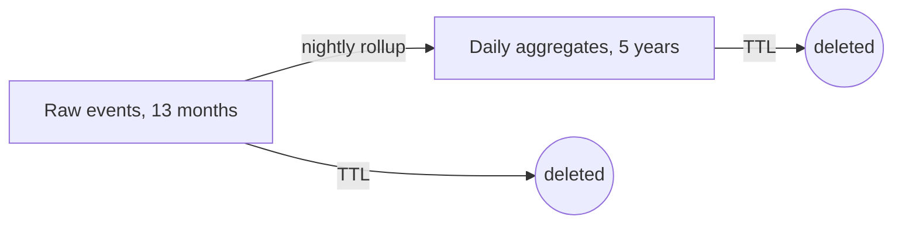

| Status | Accepted |
| -- | -- |
| Created | 2025-11-18 |
| Authors | DemoNina |
| Reviewers | DemoCarol, DemoPeggy |
| Target | Q1 2026 |
| Decision | [ADR-027 Retain raw events for 13 months](@ADR-027) |

## Summary

Keep raw analytics events and the analytics copy of domain events for 13 months, keep daily aggregates for 5 years, and delete everything older automatically, with no personal data in what stays.

## Motivation

* ClickHouse holds 22 months of raw events, 410 GB compressed, growing 19 GB a month ([RN-023](@RN-023)).
* No report reads raw events older than 13 months; year-over-year comparisons need 13 months, not more.
* Raw events contain session ids and coarse location. Keeping them indefinitely contradicts the data minimisation rule in DemoCompany's privacy policy.

## Proposal

### Periods

| Data | Where | Kept | Then |
| -- | -- | -- | -- |
| Raw analytics events | ClickHouse | 13 months | partition dropped |
| Analytics copy of domain events | ClickHouse | 13 months | partition dropped |
| Daily aggregates | ClickHouse | 5 years | deleted |
| Domain events on Kafka | Kafka | 7 days | segment deleted |
| Archived order partitions | object storage | 7 years | lifecycle rule ([RFC-019](@RFC-019)) |

The full table is [SPEC-027](@SPEC-027).

### Mechanism

ClickHouse tables get a TTL on `event_date`, and partitions are monthly, so expired data goes as whole parts:

```sql
ALTER TABLE analytics.events
    MODIFY TTL event_date + INTERVAL 13 MONTH DELETE;

ALTER TABLE analytics.events_daily
    MODIFY TTL day + INTERVAL 5 YEAR DELETE;
```

### Aggregates carry no personal data

Daily aggregates are grouped by date, event type, platform, country and category only. Session ids never enter them.



## Alternatives

| Option | Storage in 2027 | Year-over-year reports | Why not |
| -- | -- | -- | -- |
| Keep everything | 870 GB | yes | No reason to keep it; privacy risk |
| 6 months raw | 120 GB | from aggregates only | Analysts lose drill-down for seasonal comparisons |
| **13 months raw, 5 years aggregates** | **250 GB** | **yes** | Chosen |

## Rollout

- [X] Daily aggregate tables, backfilled for 22 months
- [X] TTL on staging, checked that only whole parts are dropped
- [ ] TTL on production
- [ ] Remove the 9 months of raw events past the limit, after an export check with analytics

## Open questions

* Do fraud models need raw checkout events longer? Their training set uses 12 months today.
