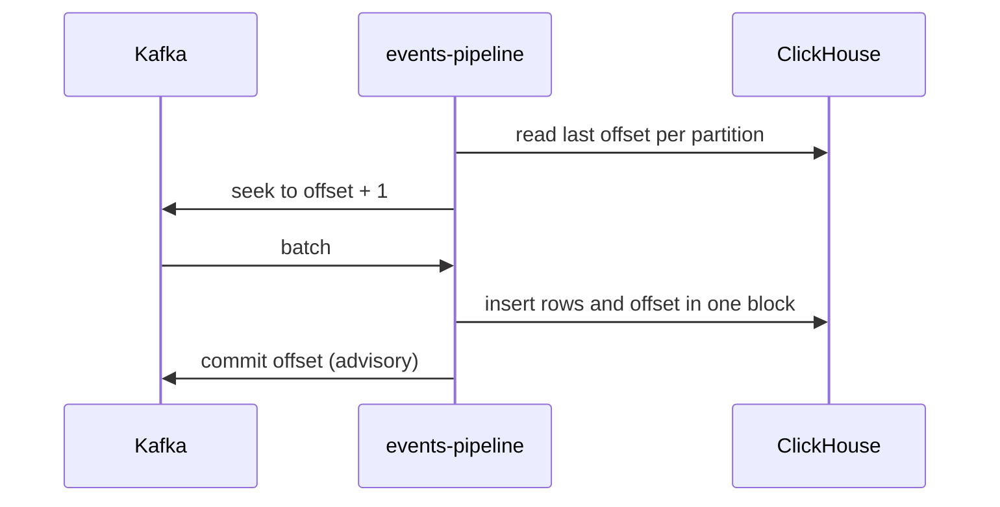

| Status | Rejected |
| -- | -- |
| Created | 2025-12-02 |
| Authors | DemoIvan |
| Reviewers | DemoCarol, DemoNina, DemoKen |
| Target | Q1 2026 |
| Decision | Rejected 2026-01-13; consumers stay at-least-once and idempotent |

## Summary

Use Kafka transactions so `events-pipeline` reads, transforms and writes each event exactly once, end to end from Kafka to ClickHouse.

## Motivation

* `events-pipeline` delivers at least once. After a rebalance or a crash, it re-inserts up to one batch: 0.02 % of rows were duplicates in November 2025.
* Analysts remove duplicates with `FINAL` or `GROUP BY id`, which makes some queries 3 to 5 times slower ([RN-025](@RN-025)).

## Proposal

### Kafka side

Enable transactions in the pipeline's producer and read with `isolation.level=read_committed`.

```properties
enable.idempotence=true
transactional.id=events-pipeline-${partition}
isolation.level=read_committed
```

### ClickHouse side

ClickHouse has no transaction with Kafka. The proposal stores the last committed Kafka offset per partition in a ClickHouse table, writes it in the same insert block as the data, and on restart resumes from that offset instead of Kafka's committed offset.



## Why it was rejected

The review measured the proposal on staging for two weeks.

| Measure | At-least-once today | Exactly-once proposal |
| -- | -- | -- |
| Duplicate rows | 0.02 % | 0 % |
| Insert throughput | 410,000 rows/s | 260,000 rows/s |
| Recovery after a crash | 8 s | 95 s |
| Code paths with special cases | 1 | 6 |

* Throughput fell by 37 %, below the peak load of the November sale.
* ClickHouse's `ReplacingMergeTree` with the envelope `id` already removes duplicates during merges; a deduplicated view covers the reports that cannot wait for merges.
* Every consumer must stay idempotent anyway ([SPEC-016](@SPEC-016) rules), because other consumers than the pipeline read the same topics.

## Alternatives

| Option | Duplicates seen by analysts | Cost | Outcome |
| -- | -- | -- | -- |
| Exactly-once with offsets in ClickHouse | none | 37 % throughput | Rejected |
| `ReplacingMergeTree` keyed by event id | **none after merge, under 1 h** | **none** | **Adopted instead** |
| Deduplicate in the pipeline with a 1-hour id cache | very few | 6 GB of memory | Kept as an option |

## Rollout

- [X] Staging trial and measurements
- [X] Switch event tables to `ReplacingMergeTree` ([SPEC-025](@SPEC-025))
- [X] Deduplicated view `analytics.events_dedup` for near-real-time reports

## Open questions

* None; reopen if duplicates rise above 0.1 %.
