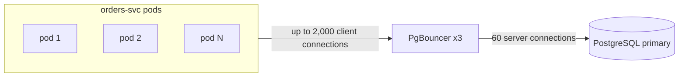

| Status | Implemented |
| -- | -- |
| Created | 2025-05-06 |
| Authors | DemoMike |
| Reviewers | DemoGrace, DemoKen |
| Target | Q3 2025 |
| Decision | none; configuration in this document |

## Summary

Put PgBouncer in transaction mode between services and every PostgreSQL primary, so the number of server connections stays fixed while pods scale.

## Motivation

* Each Go service pod opens up to 20 connections. With autoscaling, `orders-svc` reached 64 pods during the April 2025 sale: 1,280 connections against a `max_connections` of 1,000.
* Connection errors caused 0.4 % failed checkouts in the first hour of that sale.
* Each PostgreSQL connection costs about 10 MB of memory; 1,000 idle connections waste 10 GB on a 64 GB server.

## Proposal

### Placement

PgBouncer runs as a deployment of 3 pods per database cluster, behind a Kubernetes service. Services connect to PgBouncer; PgBouncer keeps a fixed pool to the primary.



### Configuration

```ini
[pgbouncer]
pool_mode = transaction
max_client_conn = 2000
default_pool_size = 20
reserve_pool_size = 5
reserve_pool_timeout = 2
server_idle_timeout = 60
max_prepared_statements = 200
```

`max_prepared_statements` lets pgx keep prepared statements in transaction mode (PgBouncer 1.21 and later).

### Pool mode

Measured in [RN-019](@RN-019): transaction mode gives 2.8 times the throughput of session mode at 1,000 clients. Statement mode breaks multi-statement transactions and is not an option.

### Service rules

| Rule | Why |
| -- | -- |
| No session state (`SET`, advisory locks across transactions, `LISTEN`) | A transaction may land on another server connection |
| Pod pool size at most 10 | PgBouncer does the pooling now |
| Migrations connect directly to the primary | They need session features |

## Alternatives

| Option | Connections at 64 pods | Why not |
| -- | -- | -- |
| Raise `max_connections` to 3,000 | 1,280 | 30 GB of memory, worse contention |
| Smaller pools per pod | 640 | Queues inside pods during spikes |
| Pooler sidecar in each pod | 1,280 | Pools per pod do not share |
| **Central PgBouncer** | **60** | Chosen |

## Rollout

- [X] PgBouncer for `orders-svc` and `checkout-svc`
- [X] Sale load test: 0 connection errors at 90 pods
- [X] All services
- [X] Alert on `cl_waiting` above 50 for 1 minute

## Open questions

* Do we need PgBouncer in front of read replicas too ([RFC-022](@RFC-022))? Probably yes, with its own pool.
