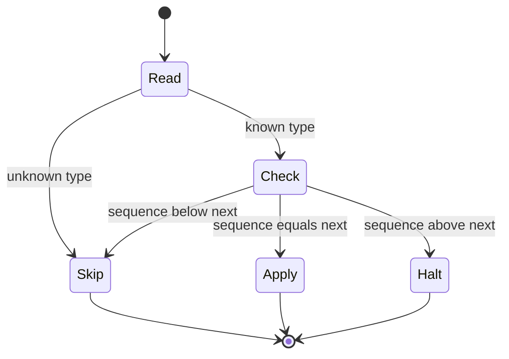

| Status | Stable |
| -- | -- |
| Version | 1.3 |
| Updated | 2026-03-12 |
| Owner | DemoCarol |
| Applies to | Every event on Kafka, domain events and change data capture alike |

## Overview

Every event DemoMart publishes is wrapped in the same envelope, whatever its payload. Consumers can route, deduplicate and trace an event from the envelope alone, without decoding the payload. The payload is Protobuf ([ADR-026](@ADR-026)); the envelope is a Protobuf message too, and its fields are copied into Kafka headers so tools that cannot decode Protobuf still see them.

## Fields

| Field | Type | Required | Kafka header | Description |
| -- | -- | -- | -- | -- |
| `id` | string (UUIDv7) | yes | `ce-id` | Unique per event; consumers deduplicate on it |
| `type` | string | yes | `ce-type` | `<domain>.<aggregate>.<event>.v<major>`, for example `orders.order.confirmed.v1` |
| `source` | string | yes | `ce-source` | The producing service, for example `orders-svc` |
| `subject` | string | yes | `ce-subject` | The aggregate id; also the Kafka message key |
| `time` | timestamp (UTC) | yes | `ce-time` | When the change happened, not when it was published |
| `sequence` | uint64 | yes | `ce-sequence` | Per aggregate, increases by one with every event |
| `trace_parent` | string | no | `traceparent` | W3C trace context of the request that caused the event ([SPEC-005](@SPEC-005)) |
| `schema_id` | int32 | yes | `ce-schemaid` | The payload's schema in the registry ([RFC-018](@RFC-018)) |
| `payload` | bytes | yes | | The Protobuf-encoded payload |

The header names follow CloudEvents' Kafka binding, so generic CloudEvents tooling can read them.

## Definition

```protobuf
syntax = "proto3";
package demomart.events.v1;

import "google/protobuf/timestamp.proto";

message Envelope {
  string id = 1;
  string type = 2;
  string source = 3;
  string subject = 4;
  google.protobuf.Timestamp time = 5;
  uint64 sequence = 6;
  string trace_parent = 7;
  int32 schema_id = 8;
  bytes payload = 9;
}
```

## Rules for consumers

1. Read `type` first; skip types you do not handle without decoding the payload.
2. Apply an event only if its `sequence` is the next one for its `subject`. A lower sequence is a duplicate: skip it. A gap means an event is missing: stop the partition and alert.
3. Never rely on the order of events with different subjects.
4. A payload that does not decode goes to the consumer's dead letter topic ([SPEC-028](@SPEC-028)).



## Version history

| Version | Date | Change |
| -- | -- | -- |
| 1.0 | 2025-02-24 | First version, with `id`, `type`, `source`, `subject`, `time`, `payload` |
| 1.1 | 2025-04-02 | `sequence` per aggregate |
| 1.2 | 2025-07-15 | `schema_id` with the schema registry |
| 1.3 | 2026-03-12 | Envelope fields copied into CloudEvents headers |

## Related

* [ADR-005 Use Kafka for domain events](@ADR-005)
* [SPEC-017 Order events](@SPEC-017)
* [SPEC-021 Kafka topic naming and configuration](@SPEC-021)
