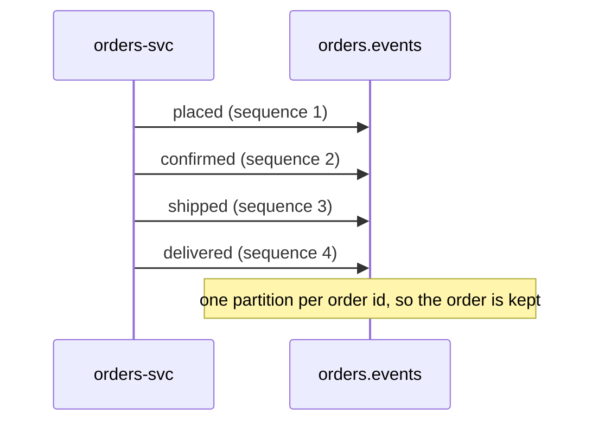

| Status | Stable |
| -- | -- |
| Version | 2.1 |
| Updated | 2026-05-19 |
| Owner | DemoErin |
| Applies to | Topic `orders.events`, produced by `orders-svc` |

## Overview

`orders-svc` publishes one event for every change of an order's state. Each event is wrapped in the [domain event envelope](@SPEC-016): `subject` is the order id, `source` is `orders-svc`, and `sequence` counts the order's events from 1. The states and transitions are those of the [order state machine](@SPEC-047).

## Event types

| Type | When | Main consumers |
| -- | -- | -- |
| `orders.order.placed.v2` | Checkout created the order, payment not yet captured | `demo-pay`, `recon-svc` |
| `orders.order.confirmed.v2` | Payment captured | `fulfilment-svc`, `notify-svc`, `recon-svc` |
| `orders.order.shipped.v2` | All shipments handed to carriers | `notify-svc` |
| `orders.order.delivered.v2` | Carrier reported delivery of the last shipment | `notify-svc`, `demo-pay` (payout clock) |
| `orders.order.cancelled.v2` | Cancelled by the buyer, the seller or fraud checks | `demo-pay`, `notify-svc`, `recon-svc` |
| `orders.order.refunded.v2` | A full or partial refund completed | `notify-svc`, `recon-svc` |

## Payload

All order events share one payload message; fields that do not apply to an event are empty.

```protobuf
syntax = "proto3";
package demomart.orders.v2;

import "google/protobuf/timestamp.proto";

message OrderEvent {
  string order_id = 1;
  string buyer_id = 2;
  string status = 3;                  // placed, confirmed, shipped, delivered, cancelled, refunded
  int64 total_minor = 4;              // ADR-020: integer minor units
  string currency = 5;                // ISO 4217
  repeated Line lines = 6;
  string cancel_reason = 7;           // cancelled only
  int64 refunded_minor = 8;           // refunded only, cumulative
  google.protobuf.Timestamp placed_at = 9;

  message Line {
    string line_id = 1;
    string seller_id = 2;
    string product_id = 3;
    int32 quantity = 4;
    int64 unit_price_minor = 5;
  }
}
```

The payload carries no names or addresses: consumers that need the delivery address call `orders-svc` ([RFC-029](@RFC-029)).

## Example

An `orders.order.confirmed.v2` event, envelope shown as JSON for reading:

```json
{
  "id": "0192f1c4-7a3e-7b10-9c55-3e2a51d0c8a4",
  "type": "orders.order.confirmed.v2",
  "source": "orders-svc",
  "subject": "0192f1c2-11d0-7c4e-8a10-6f1b2e9d0a77",
  "time": "2026-05-19T10:42:07.118Z",
  "sequence": 2,
  "schema_id": 412,
  "payload": {
    "order_id": "0192f1c2-11d0-7c4e-8a10-6f1b2e9d0a77",
    "status": "confirmed",
    "total_minor": 4598,
    "currency": "EUR",
    "lines": [{ "line_id": "l1", "product_id": "p-31877", "quantity": 2, "unit_price_minor": 2299 }]
  }
}
```

## Ordering



## Limits

| Limit | Value |
| -- | -- |
| Lines per event | 200; larger orders are refused at checkout |
| Payload size | 64 KB |
| Publish delay after the state change | p99 under 2 s through the outbox ([SPEC-022](@SPEC-022)) |

## Version history

| Version | Date | Change |
| -- | -- | -- |
| 1.0 | 2025-03-03 | First version: placed, confirmed, cancelled |
| 1.1 | 2025-06-10 | shipped and delivered |
| 2.0 | 2025-12-08 | Money as integer minor units ([ADR-020](@ADR-020)); v1 published in parallel for 30 days |
| 2.1 | 2026-05-19 | `refunded` event with cumulative `refunded_minor` |

## Related

* [SPEC-019 Payment events](@SPEC-019)
* [SPEC-021 Kafka topic naming and configuration](@SPEC-021)
* [ADR-021 Keep the order state machine in orders-svc](@ADR-021)
