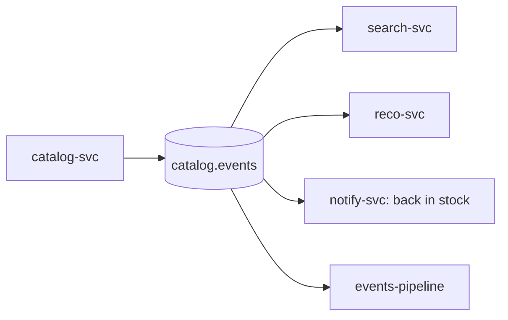

| Status | Draft |
| -- | -- |
| Version | 0.4 |
| Updated | 2026-09-29 |
| Owner | DemoKen |
| Applies to | Topic `catalog.events`, produced by `catalog-svc` |

## Overview

Domain events for products, published by `catalog-svc` through its outbox ([ADR-014](@ADR-014)). They complement, and will partly replace, the row-level change stream of [RFC-017](@RFC-017): change data capture tells consumers that a row changed; product events tell them what happened to a product, in the catalog's own words.

Every event uses the [domain event envelope](@SPEC-016) with `subject` set to the product id.

## Event types

| Type | When | Replaces from change data capture |
| -- | -- | -- |
| `catalog.product.listed.v1` | A seller published a product | insert into `products` |
| `catalog.product.updated.v1` | Title, description, attributes or images changed | update of `products`, `product_variants` |
| `catalog.product.price_changed.v1` | A variant's price changed | update of `prices` |
| `catalog.product.stock_changed.v1` | Available stock crossed zero, or changed by 10 % or more | update of `stock_levels` |
| `catalog.product.delisted.v1` | Removed by the seller or by moderation | delete or `status = 'delisted'` |

Small stock changes are not published: they would make up 94 % of all events and most consumers only care whether a product can be bought.

## Payload

```protobuf
syntax = "proto3";
package demomart.catalog.v1;

message ProductEvent {
  string product_id = 1;
  string seller_id = 2;
  string category_id = 3;
  string title = 4;
  repeated Variant variants = 5;
  string delist_reason = 6;          // delisted only: seller, moderation, policy

  message Variant {
    string variant_id = 1;
    string sku = 2;
    int64 price_minor = 3;
    string currency = 4;
    int32 available = 5;             // stock events only
  }
}
```

## Consumers



## Open points in this draft

- [X] Event types agreed with search and recommendations
- [ ] Threshold for `stock_changed`: 10 % or a fixed number of units?
- [ ] Move `search-svc` from change data capture to these events, or keep both?
- [ ] Image changes: own event type or part of `updated`?

## Limits

| Limit | Value |
| -- | -- |
| Variants per product | 100 |
| Payload size | 128 KB |
| Events per product per minute | 60; more are merged into one `updated` |

## Version history

| Version | Date | Change |
| -- | -- | -- |
| 0.1 | 2026-06-22 | First draft |
| 0.2 | 2026-07-14 | `stock_changed` only on meaningful changes |
| 0.3 | 2026-08-30 | `delist_reason` |
| 0.4 | 2026-09-29 | Merge rule for bursts of updates |

## Related

* [SPEC-024 Catalog database schema](@SPEC-024)
* [SPEC-060 Product index mapping](@SPEC-060)
* [ADR-005 Use Kafka for domain events](@ADR-005)
