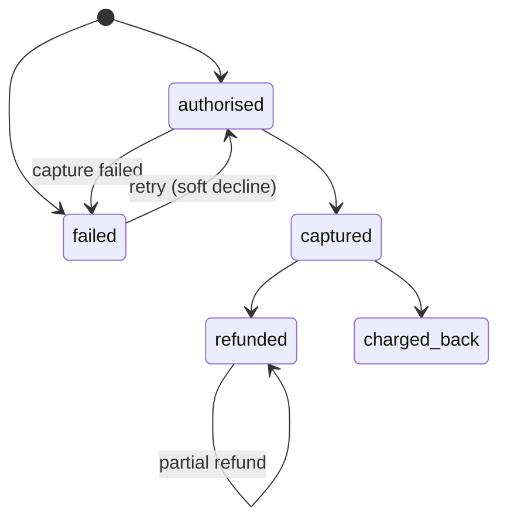

| Status | Stable |
| -- | -- |
| Version | 1.4 |
| Updated | 2026-07-02 |
| Owner | DemoPeggy |
| Applies to | Topic `payments.events`, produced by `demo-pay` |

## Overview

`demo-pay`, the payment orchestrator ([ADR-038](@ADR-038)), publishes an event for each change of a payment intent ([SPEC-048](@SPEC-048)). Events use the [domain event envelope](@SPEC-016) with `subject` set to the **order id**, not the payment id, so payment and order events for the same order land in the same partition number of their topics and [reconciliation](@RFC-025) can join them cheaply.

## Event types

| Type | When |
| -- | -- |
| `payments.payment.authorised.v1` | The provider authorised the amount |
| `payments.payment.captured.v1` | Funds captured |
| `payments.payment.failed.v1` | Authorisation or capture failed, with a decline category |
| `payments.payment.refunded.v1` | A refund completed, full or partial |
| `payments.payment.charged_back.v1` | The card issuer reversed the payment |

## Payload

```protobuf
syntax = "proto3";
package demomart.payments.v1;

message PaymentEvent {
  string payment_id = 1;
  string order_id = 2;
  string method = 3;              // card, wallet, bank_transfer, pay_later
  int64 amount_minor = 4;
  string currency = 5;
  int64 refunded_minor = 6;       // cumulative
  string decline_category = 7;    // failed only: soft, hard, fraud
  string provider = 8;            // demo-acquirer-a, demo-acquirer-b
  int32 attempt = 9;              // retries for soft declines
}
```

Card numbers, tokens and bank details never appear in events.

## States



## Delivery guarantees

| Guarantee | Value |
| -- | -- |
| Delivery | at least once; consumers deduplicate on envelope `id` |
| Order | per order id, by `sequence` |
| Delay after the provider's answer | p99 under 3 s |
| Retention on Kafka | 7 days ([SPEC-021](@SPEC-021)) |

## Example

```json
{
  "type": "payments.payment.failed.v1",
  "subject": "0192f1c2-11d0-7c4e-8a10-6f1b2e9d0a77",
  "sequence": 1,
  "payload": {
    "payment_id": "pay_8f3c1d",
    "method": "card",
    "amount_minor": 4598,
    "currency": "EUR",
    "decline_category": "soft",
    "provider": "demo-acquirer-a",
    "attempt": 1
  }
}
```

## Version history

| Version | Date | Change |
| -- | -- | -- |
| 1.0 | 2025-03-17 | authorised, captured, failed, refunded |
| 1.1 | 2025-06-24 | `subject` is the order id |
| 1.2 | 2025-10-06 | `charged_back` |
| 1.3 | 2026-02-11 | `decline_category` and `attempt` for retries ([RFC-050](@RFC-050)) |
| 1.4 | 2026-07-02 | `pay_later` method ([RFC-048](@RFC-048)) |

## Related

* [SPEC-017 Order events](@SPEC-017)
* [SPEC-049 Payment method types](@SPEC-049)
