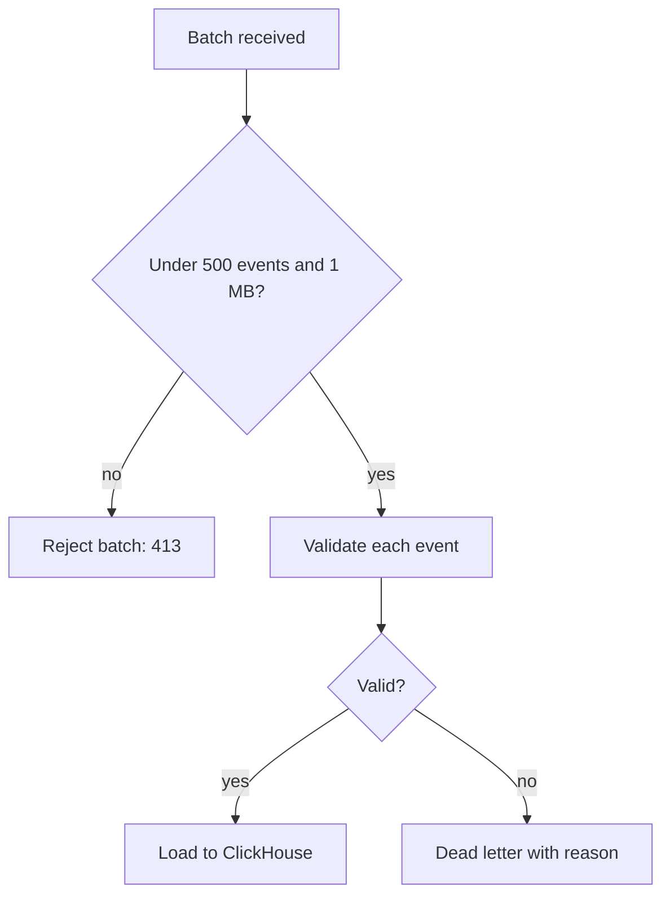

| Status | Stable |
| -- | -- |
| Version | 3.0 |
| Updated | 2026-04-14 |
| Owner | DemoNina |
| Applies to | Events sent by the web shop, the app and Seller Hub to `events-pipeline` |

## Overview

Analytics events describe what people do in DemoMart's interfaces: views, searches, clicks, add-to-cart. Clients send them to `events-pipeline` over HTTPS in batches. The pipeline wraps each one in the [domain event envelope](@SPEC-016) (`source` is the client, `subject` is the session id) and loads it into [ClickHouse](@SPEC-025).

Analytics events carry no personal data: no names, no addresses, no free text typed by people except search queries, which are cut to 100 characters.

## Common fields

| Field | Type | Required | Example |
| -- | -- | -- | -- |
| `event` | string | yes | `product_viewed` |
| `time` | RFC 3339 timestamp | yes | `2026-04-14T09:15:22.401Z` |
| `session_id` | UUID | yes | random per session, rotated after 30 min of inactivity |
| `platform` | enum | yes | `web`, `ios`, `android`, `seller_hub` |
| `app_version` | string | for apps | `6.18.0` |
| `country` | ISO 3166 code | yes | derived from the IP address, which is then dropped |
| `properties` | object | per event | see below |

## Events

| Event | Properties |
| -- | -- |
| `page_viewed` | `page_type`, `path_template` |
| `search_performed` | `query`, `results`, `filters` |
| `product_viewed` | `product_id`, `category_id`, `position`, `list` |
| `cart_item_added` | `product_id`, `variant_id`, `quantity`, `price_minor`, `currency` |
| `checkout_step_viewed` | `step` (1 to 4), `cart_value_minor` |
| `order_placed` | `order_id`, `value_minor`, `currency`, `items` |

## Batch request

```json
{
  "sent_at": "2026-04-14T09:15:30.000Z",
  "events": [
    {
      "event": "search_performed",
      "time": "2026-04-14T09:15:22.401Z",
      "session_id": "6a1f0d5e-2b47-4f7c-9a2e-0c1d33f6a812",
      "platform": "web",
      "country": "DE",
      "properties": { "query": "oak side table", "results": 214, "filters": ["material:oak"] }
    }
  ]
}
```

## Validation



An invalid event never rejects its batch; it goes to the pipeline's dead letter topic ([SPEC-028](@SPEC-028)).

## Limits

| Limit | Value |
| -- | -- |
| Events per batch | 500 |
| Batch size | 1 MB |
| Clock skew accepted | `time` up to 24 h in the past, 5 min in the future |
| Property keys per event | 30 |

## Version history

| Version | Date | Change |
| -- | -- | -- |
| 1.0 | 2025-05-26 | First version, web only |
| 2.0 | 2025-09-15 | App and Seller Hub; `platform` required |
| 2.1 | 2025-12-01 | `checkout_step_viewed` |
| 3.0 | 2026-04-14 | IP addresses dropped after country lookup; `user_id` removed |

## Related

* [RFC-020 Moving analytics events to ClickHouse](@RFC-020)
* [SPEC-065 Search analytics events](@SPEC-065)
* [SPEC-073 App analytics events](@SPEC-073)
