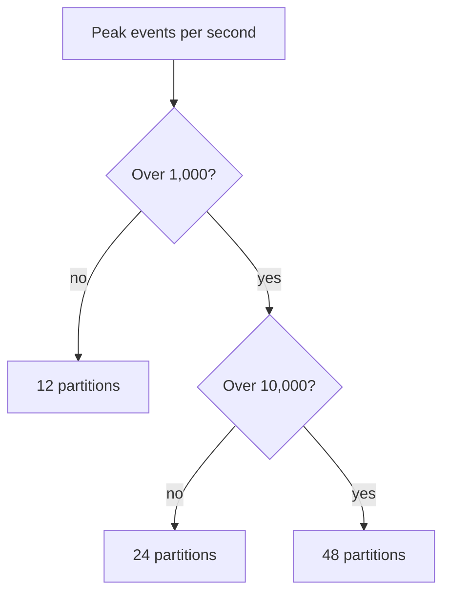

| Status | Stable |
| -- | -- |
| Version | 2.0 |
| Updated | 2026-01-20 |
| Owner | DemoIvan |
| Applies to | Every topic on DemoMart's Kafka clusters |

## Overview

How topics are named, partitioned and configured. Topics are declared in Terraform ([ADR-009](@ADR-009)); a topic created any other way is deleted by the nightly drift check.

## Names

```text
<domain>.<kind>[.<name>]
```

| Kind | Pattern | Example | Producer |
| -- | -- | -- | -- |
| Domain events | `<domain>.events` | `orders.events` | the owning service, through its outbox |
| Change data capture | `<domain>.cdc.<table>` | `catalog.cdc.prices` | Debezium ([RFC-017](@RFC-017)) |
| Dead letters | `dlq.<consumer-group>` | `dlq.notify-svc` | the consumer ([RFC-028](@RFC-028)) |
| Backfills | `backfill.<consumer>.<date>` | `backfill.notify-svc.2026-10-02` | `backfill-svc` ([RFC-027](@RFC-027)) |
| Internal state | `<service>.internal.<name>` | `recon-svc.internal.open-orders` | Kafka Streams, never read by others |

Names are lowercase, use dots between parts and hyphens inside a part, and never contain a version: versions live in the event type ([SPEC-016](@SPEC-016)).

## Default configuration

| Setting | Domain events | Change data capture | Dead letters | Internal |
| -- | -- | -- | -- | -- |
| Partitions | 48 | 24 | 6 | as the source |
| Replication factor | 3 | 3 | 3 | 3 |
| `min.insync.replicas` | 2 | 2 | 2 | 2 |
| `retention.ms` | 7 days | 3 days | 30 days | compacted |
| `cleanup.policy` | delete | delete | delete | compact |
| `compression.type` | zstd | zstd | zstd | zstd |
| `max.message.bytes` | 1 MB | 1 MB | 2 MB | 1 MB |

## Declaration

```hcl
module "orders_events" {
  source             = "../modules/kafka-topic"
  name               = "orders.events"
  partitions         = 48
  retention_days     = 7
  owner_team         = "orders"
  consumers          = ["fulfilment-svc", "notify-svc", "demo-pay", "recon-svc", "events-pipeline"]
}
```

The `consumers` list creates the consumer groups' read grants and their dead letter topics.

## Keys

The message key is the envelope's `subject`. For domain events it is the aggregate id, so all events of one aggregate share a partition. Never use a random key or no key: ordering per aggregate is the contract.

## Partition count



Partitions can be added but never removed, and adding them moves keys to new partitions; plan for two years of growth ([RN-023](@RN-023)).

## Version history

| Version | Date | Change |
| -- | -- | -- |
| 1.0 | 2025-02-24 | Names for domain events, defaults |
| 1.1 | 2025-04-08 | Dead letter topics |
| 1.2 | 2025-06-30 | Change data capture topics |
| 2.0 | 2026-01-20 | Topics declared in Terraform only; drift check |

## Related

* [ADR-005 Use Kafka for domain events](@ADR-005)
* [RN-018 Consumer lag during peak sales](@RN-018)
