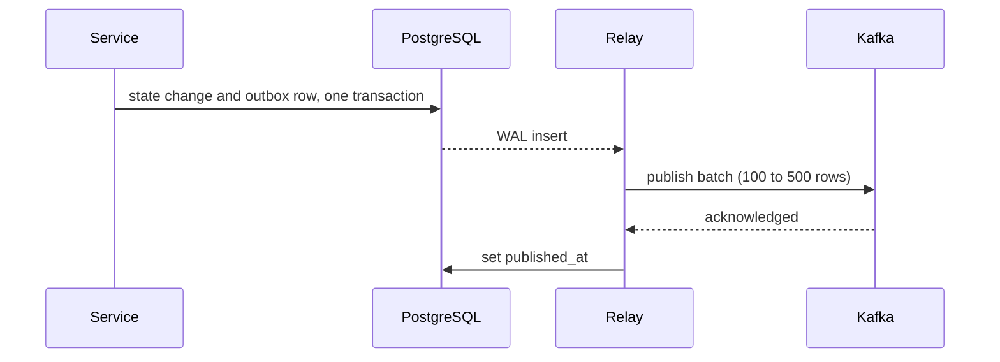

| Status | Stable |
| -- | -- |
| Version | 1.2 |
| Updated | 2026-02-03 |
| Owner | DemoCarol |
| Applies to | Every service that publishes domain events ([ADR-014](@ADR-014)) |

## Overview

A service never publishes to Kafka from a request handler. It writes the event into an `outbox` table in the same transaction as the state change, and a relay publishes the rows to Kafka in order. The event exists if and only if the change committed.

## Table

```sql
CREATE TABLE outbox (
    position     bigint GENERATED ALWAYS AS IDENTITY PRIMARY KEY,
    event_id     uuid        NOT NULL UNIQUE,
    topic        text        NOT NULL,
    subject      text        NOT NULL,
    sequence     bigint      NOT NULL,
    event_type   text        NOT NULL,
    envelope     bytea       NOT NULL,
    created_at   timestamptz NOT NULL DEFAULT now(),
    published_at timestamptz
);

CREATE INDEX outbox_unpublished ON outbox (position) WHERE published_at IS NULL;
```

| Column | Meaning |
| -- | -- |
| `position` | Publication order within the service |
| `event_id` | The envelope `id` ([SPEC-016](@SPEC-016)) |
| `topic` | Target topic ([SPEC-021](@SPEC-021)) |
| `subject`, `sequence` | Copied from the envelope; the key and the per-aggregate counter |
| `envelope` | The full encoded envelope, payload included |
| `published_at` | Set by the relay after Kafka acknowledged the row |

## Writing

```sql
BEGIN;
UPDATE orders SET status = 'confirmed' WHERE id = $1;
INSERT INTO outbox (event_id, topic, subject, sequence, event_type, envelope)
VALUES ($2, 'orders.events', $1, $3, 'orders.order.confirmed.v2', $4);
COMMIT;
```

`sequence` comes from a counter column on the aggregate row, incremented in the same transaction.

## Relay

The relay tails the write-ahead log for inserts into `outbox` ([RN-026](@RN-026) compared this with polling), publishes in batches of 100 to 500 rows, and marks them published.



If the relay crashes after Kafka acknowledged but before `published_at` was set, the rows are published again; consumers deduplicate on `event_id`.

## Cleanup

| Rule | Value |
| -- | -- |
| Published rows deleted after | 3 days |
| Alert when unpublished rows are older than | 60 s |
| Alert when unpublished rows exceed | 50,000 |

## Version history

| Version | Date | Change |
| -- | -- | -- |
| 1.0 | 2025-06-30 | First version, relay polls every 500 ms |
| 1.1 | 2025-09-22 | `sequence` column |
| 1.2 | 2026-02-03 | Relay tails the WAL instead of polling |

## Related

* [ADR-014 Publish events through a transactional outbox](@ADR-014)
* [SPEC-017 Order events](@SPEC-017)
