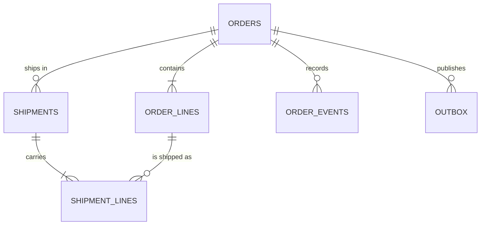

| Status | Stable |
| -- | -- |
| Version | 3.0 |
| Updated | 2026-04-30 |
| Owner | DemoErin |
| Applies to | The `orders` database of `orders-svc`, PostgreSQL 16 |

## Overview

`orders-svc` owns this database alone ([ADR-015](@ADR-015)). Other services read orders through its API ([SPEC-037](@SPEC-037)) or its [events](@SPEC-017). Since version 3.0 the two large tables are partitioned by month ([RFC-019](@RFC-019)).

## Entities



## Tables

| Table | Rows (Oct 2026) | Partitioned | Notes |
| -- | -- | -- | -- |
| `orders` | 63 million | by month of `created_at` | Delivery name and address encrypted ([RFC-029](@RFC-029)) |
| `order_lines` | 194 million | by month of `created_at` | One row per product variant |
| `shipments` | 71 million | no | One per seller and carrier |
| `shipment_lines` | 190 million | no | Which lines are in which shipment |
| `order_events` | 240 million | no | Audit trail of state changes |
| `outbox` | about 1 million | no | [SPEC-022](@SPEC-022) |

## `orders`

| Column | Type | Null | Description |
| -- | -- | -- | -- |
| `id` | uuid | no | UUIDv7; part of the primary key |
| `created_at` | timestamptz | no | Partition key; part of the primary key |
| `buyer_id` | uuid | no | From `identity-svc` |
| `status` | text | no | See [the state machine](@SPEC-047) |
| `total_minor` | bigint | no | Integer minor units ([ADR-020](@ADR-020)) |
| `currency` | char(3) | no | ISO 4217 |
| `delivery_sealed` | jsonb | no | Encrypted name and address |
| `delivery_postcode` | text | no | Kept in clear for routing |
| `version` | bigint | no | Optimistic locking and event `sequence` |

```sql
CREATE TABLE order_lines (
    order_id          uuid        NOT NULL,
    created_at        timestamptz NOT NULL,
    line_id           smallint    NOT NULL,
    seller_id         uuid        NOT NULL,
    product_id        text        NOT NULL,
    variant_id        text        NOT NULL,
    quantity          integer     NOT NULL CHECK (quantity > 0),
    unit_price_minor  bigint      NOT NULL,
    PRIMARY KEY (order_id, created_at, line_id)
) PARTITION BY RANGE (created_at);
```

## Indexes

| Index | Columns | Used by |
| -- | -- | -- |
| `orders_pkey` | `id, created_at` | lookups by id with derived time bounds |
| `orders_buyer` | `buyer_id, created_at DESC` | the buyer's order list |
| `orders_status_open` | `status` where status in open states | fulfilment and reconciliation |
| `order_lines_seller` | `seller_id, created_at DESC` | Seller Hub order list |

## Migration rules

* Migrations are expand-then-contract: add a column, deploy code that writes both, backfill, switch reads, drop the old column. Never rename in place.
* A migration that rewrites a partitioned table runs per partition, newest first.
* Locks above 2 seconds abort the migration (`lock_timeout = '2s'`).

## Version history

| Version | Date | Change |
| -- | -- | -- |
| 1.0 | 2025-10-27 | First version, after the move out of the shared database ([RFC-016](@RFC-016)) |
| 2.0 | 2026-01-19 | Delivery fields encrypted |
| 3.0 | 2026-04-30 | Monthly partitions for `orders` and `order_lines` |
