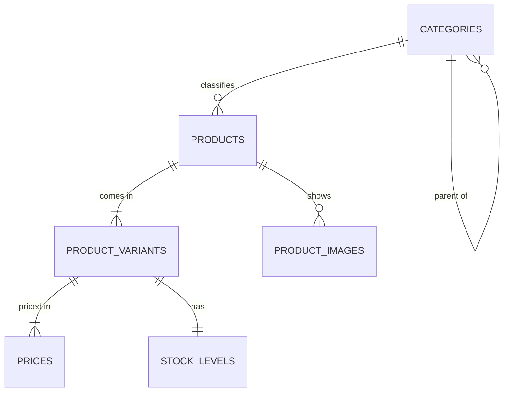

| Status | Stable |
| -- | -- |
| Version | 2.2 |
| Updated | 2026-06-08 |
| Owner | DemoKen |
| Applies to | The `catalog` database of `catalog-svc`, PostgreSQL 16 |

## Overview

The catalog holds every product listed on DemoMart, its variants, prices, stock and images. `catalog-svc` owns it; search and analytics receive its changes through change data capture ([RFC-017](@RFC-017)) and, later, [product events](@SPEC-018).

## Entities



## Tables

| Table | Rows (Oct 2026) | Change data capture | Notes |
| -- | -- | -- | -- |
| `categories` | 3,412 | no | Tree, at most 5 levels |
| `products` | 9.8 million | yes | One per listing |
| `product_variants` | 31 million | yes | Size, colour, material |
| `prices` | 34 million | yes | One per variant and currency |
| `stock_levels` | 31 million | yes | Updated by sellers and by inventory sync ([SPEC-080](@SPEC-080)) |
| `product_images` | 52 million | no | Paths on the image CDN ([ADR-041](@ADR-041)) |

## `products`

```sql
CREATE TABLE products (
    id           text        PRIMARY KEY,           -- p-<base36>
    seller_id    uuid        NOT NULL,
    category_id  integer     NOT NULL REFERENCES categories(id),
    status       text        NOT NULL CHECK (status IN ('draft', 'listed', 'delisted')),
    title        text        NOT NULL CHECK (length(title) BETWEEN 3 AND 140),
    description  text        NOT NULL DEFAULT '',
    attributes   jsonb       NOT NULL DEFAULT '{}',
    quality      smallint,                          -- listing quality score, SPEC-085
    created_at   timestamptz NOT NULL DEFAULT now(),
    updated_at   timestamptz NOT NULL DEFAULT now()
);
```

Field rules for sellers are in [SPEC-079](@SPEC-079).

## `prices`

| Column | Type | Description |
| -- | -- | -- |
| `variant_id` | text | The variant |
| `currency` | char(3) | ISO 4217 |
| `amount_minor` | bigint | Integer minor units ([ADR-020](@ADR-020)) |
| `compare_at_minor` | bigint, null | Former price, shown struck through |
| `valid_from` | timestamptz | Scheduled price changes |

## Read paths

| Path | Queries per second (peak) | Served from |
| -- | -- | -- |
| Product page | 21,000 | primary today; replicas proposed in [RFC-022](@RFC-022) |
| Seller Hub listing editor | 900 | primary |
| Checkout price check | 1,400 | primary |
| Search indexing | none | change data capture stream |

## Limits

| Limit | Value |
| -- | -- |
| Variants per product | 100 |
| Images per product | 12 |
| `attributes` size | 16 KB |

## Version history

| Version | Date | Change |
| -- | -- | -- |
| 1.0 | 2025-08-25 | After the move out of the shared database |
| 2.0 | 2025-11-10 | Prices per currency |
| 2.1 | 2026-03-02 | `compare_at_minor` |
| 2.2 | 2026-06-08 | `quality` column |
