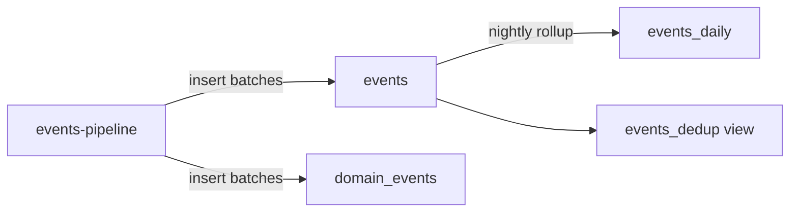

| Status | Stable |
| -- | -- |
| Version | 2.0 |
| Updated | 2026-02-16 |
| Owner | DemoNina |
| Applies to | Database `analytics` on the ClickHouse cluster |

## Overview

The tables that hold analytics events ([SPEC-020](@SPEC-020)) and the analytics copy of domain events, loaded by `events-pipeline` ([RFC-020](@RFC-020)). Version 2.0 changed the sort key and the engine after [RN-025](@RN-025) and [RFC-024](@RFC-024).

## Tables

| Table | Engine | Rows (Oct 2026) | Kept |
| -- | -- | -- | -- |
| `events` | `ReplicatedReplacingMergeTree(ingested_at)` | 7.4 billion | 13 months |
| `domain_events` | `ReplicatedReplacingMergeTree(ingested_at)` | 1.9 billion | 13 months |
| `events_daily` | `ReplicatedSummingMergeTree` | 41 million | 5 years |
| `events_dedup` | view over `events` | | |

## `events`

```sql
CREATE TABLE analytics.events ON CLUSTER main
(
    event_id     UUID,
    event_date   Date,
    event_time   DateTime64(3, 'UTC'),
    event_type   LowCardinality(String),
    platform     LowCardinality(String),
    country      LowCardinality(FixedString(2)),
    session_id   UUID,
    product_id   String DEFAULT '',
    properties   String CODEC(ZSTD(3)),
    ingested_at  DateTime64(3, 'UTC')
)
ENGINE = ReplicatedReplacingMergeTree('/clickhouse/{shard}/analytics/events', '{replica}', ingested_at)
PARTITION BY toYYYYMM(event_date)
ORDER BY (event_type, event_date, platform, event_id)
TTL event_date + INTERVAL 13 MONTH DELETE
SETTINGS index_granularity = 8192;
```

Codecs for the other columns follow [RN-017](@RN-017): `Delta, ZSTD` for times, `LZ4` for low-cardinality strings.

## Why this sort key

| Query shape | Share of queries | Sort key prefix used |
| -- | -- | -- |
| One event type over a date range | 71 % | `event_type, event_date` |
| One event type, one platform | 18 % | `event_type, event_date, platform` |
| Lookups by session | 6 % | none; a skip index on `session_id` helps |
| Other | 5 % | none |

`event_id` closes the key so `ReplacingMergeTree` can merge duplicates.

## Duplicates

`events-pipeline` delivers at least once. Duplicates share `event_id` and are removed when parts merge, usually within an hour. Reports that cannot wait read `events_dedup`:

```sql
CREATE VIEW analytics.events_dedup AS
SELECT * FROM analytics.events FINAL;
```

## Data flow



## Limits

| Limit | Value |
| -- | -- |
| Insert batch | at least 10,000 rows or 5 s |
| Inserts per second per table | at most 2 |
| `properties` size | 8 KB |
| Query timeout for dashboards | 30 s |

## Version history

| Version | Date | Change |
| -- | -- | -- |
| 1.0 | 2025-07-14 | First version, `MergeTree`, sorted by `event_date` first |
| 1.1 | 2025-10-20 | Codecs per column |
| 2.0 | 2026-02-16 | Sorted by `event_type` first; `ReplacingMergeTree` by `event_id` |

## Related

* [ADR-011 Store analytics events in ClickHouse](@ADR-011)
* [SPEC-027 Data retention periods](@SPEC-027)
