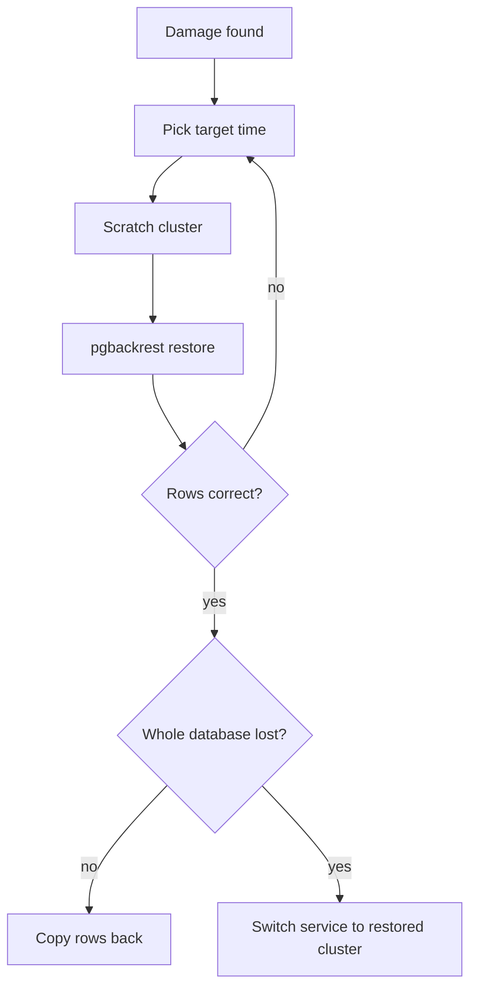

| Status | Stable |
| -- | -- |
| Version | 1.3 |
| Updated | 2026-05-05 |
| Owner | DemoMike |
| Applies to | Every PostgreSQL cluster; ClickHouse and Kafka in the last sections |

## Overview

How DemoMart's databases are backed up and how to restore them, built on [RFC-021](@RFC-021). The objectives:

| Data | Recovery point objective | Recovery time objective |
| -- | -- | -- |
| Orders, payments | 1 minute | 1 hour |
| Catalog, identity, sellers | 1 minute | 2 hours |
| Analytics (ClickHouse) | 24 hours | 8 hours |
| Kafka topics | none: rebuilt from service databases and ClickHouse | |

## PostgreSQL backups

| Backup | Schedule | Kept |
| -- | -- | -- |
| Full | daily 02:00 UTC | 14 days |
| Differential | hourly | 14 days |
| WAL | continuous, `archive_timeout = 60s` | 14 days |
| Copy in the other region | weekly | 90 days |

## Restoring to a point in time

1. Decide the target time, in UTC, just before the damage. Check `order_events` or the audit log for the last good change.
2. Create a scratch cluster from the platform template; never restore over a running primary.
3. Restore:

```sh
pgbackrest --stanza=orders --type=time \
  --target="2026-05-04 13:41:00+00" --target-action=promote \
  --delta restore
```

4. Check row counts and the last rows against the time.
5. Either copy the damaged rows back into the primary (usual case), or switch the service to the restored cluster (whole database lost).
6. Record the duration and size in the drill log ([RN-021](@RN-021)).



## Expected durations

| Database | Size | Restore from full | Plus WAL replay of 24 h |
| -- | -- | -- | -- |
| orders | 430 GB | 41 min | 12 min |
| catalog | 260 GB | 26 min | 6 min |
| payments | 120 GB | 13 min | 4 min |
| identity | 35 GB | 5 min | 1 min |

## ClickHouse

Daily backups of each table with `BACKUP TABLE ... TO S3`, kept 14 days. Lost hours can also be reloaded from Kafka within its 7 days of retention.

## Kafka

Topics are not backed up. Domain events are rebuilt from the analytics copy ([RFC-027](@RFC-027)); service state is the source of truth.

## Drills

- [X] Monthly automated PostgreSQL restore to a random point
- [X] Quarterly ClickHouse table restore
- [ ] Yearly full region loss drill, next in Q1 2027 ([RN-014](@RN-014) covers checkout failover)

## Version history

| Version | Date | Change |
| -- | -- | -- |
| 1.0 | 2025-11-03 | PostgreSQL procedure |
| 1.1 | 2025-12-15 | ClickHouse section |
| 1.2 | 2026-02-02 | Expected durations from drills |
| 1.3 | 2026-05-05 | Copy-back as the usual case |
