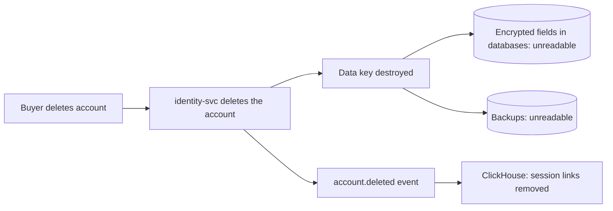

| Status | Stable |
| -- | -- |
| Version | 1.1 |
| Updated | 2026-03-09 |
| Owner | DemoPeggy |
| Applies to | Every store of DemoMart data: databases, topics, analytics, backups, logs |

## Overview

How long each kind of data is kept and how it is removed. Periods come from what the business needs, legal minimums for financial records, and [ADR-027](@ADR-027) for raw events. A store not listed here keeps data for at most 30 days.

## Periods

| Data | Store | Kept | Removal | Basis |
| -- | -- | -- | -- | -- |
| Orders and order lines | orders database | 25 months | partition detached ([RFC-019](@RFC-019)) | support and returns |
| Archived orders | object storage, Parquet | 7 years | lifecycle rule | financial records |
| Payments | payments database | 7 years | yearly job | financial records |
| Buyer accounts | identity database | while active, then 30 days | account deletion, key destroyed ([RFC-029](@RFC-029)) | account use |
| Inactive buyer accounts | identity database | 3 years without sign-in | deletion with notice | data minimisation |
| Raw analytics events | ClickHouse | 13 months | TTL | [ADR-027](@ADR-027) |
| Daily aggregates | ClickHouse | 5 years | TTL | trends |
| Domain events | Kafka | 7 days | segment deletion | [SPEC-021](@SPEC-021) |
| Dead letters | Kafka | 30 days | segment deletion | debugging |
| Service logs | log store | 30 days | index deletion | debugging |
| Traces | trace store | 7 days | TTL | debugging |
| Database backups | object storage | 14 days, weekly copies 90 days | lifecycle rule | [SPEC-026](@SPEC-026) |

## Removal must reach every copy



## Implementation

```yaml
# retention.yaml, checked nightly against every store
- store: clickhouse.analytics.events
  keep: 13 months
  method: ttl
  check: max(event_date) - min(event_date) <= 13 months
- store: kafka.orders.events
  keep: 7 days
  method: retention.ms
  check: topic config equals 604800000
```

A nightly job compares each store with this file and opens an alert when data older than its period exists.

## Exceptions

| Exception | Who decides | Longest |
| -- | -- | -- |
| Legal hold on specific orders | legal team | until released |
| Fraud investigation | payments operations | 12 months beyond the period |

## Version history

| Version | Date | Change |
| -- | -- | -- |
| 1.0 | 2025-12-15 | First version |
| 1.1 | 2026-03-09 | Archived orders and inactive accounts |

## Related

* [RFC-023 A retention policy for raw events](@RFC-023)
* [RN-023 Storage growth forecast for 2027](@RN-023)
