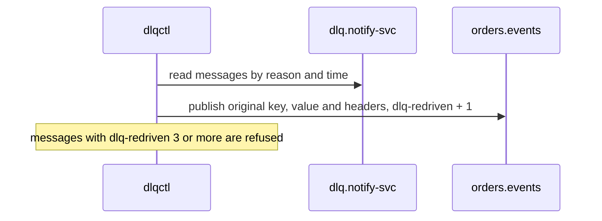

| Status | Stable |
| -- | -- |
| Version | 1.1 |
| Updated | 2025-09-08 |
| Owner | DemoIvan |
| Applies to | Topics `dlq.<consumer-group>` ([RFC-028](@RFC-028)) |

## Overview

When a consumer parks a message, it republishes the original message unchanged to its dead letter topic and adds headers that say where it came from and why it failed. Nothing is re-encoded, so a re-drive publishes exactly the original bytes.

## Message

| Part | Value |
| -- | -- |
| Key | the original key |
| Value | the original value, byte for byte |
| Original headers | kept, including the envelope's `ce-*` headers ([SPEC-016](@SPEC-016)) |
| Added headers | below |

## Added headers

| Header | Type | Example | Meaning |
| -- | -- | -- | -- |
| `dlq-original-topic` | string | `orders.events` | Where the message was read |
| `dlq-original-partition` | int | `17` | Partition |
| `dlq-original-offset` | long | `8812044` | Offset |
| `dlq-consumer-group` | string | `notify-svc` | Who failed |
| `dlq-reason` | enum | `decode_error` | See reasons |
| `dlq-error` | string | `proto: cannot parse invalid wire-format data` | First 1,000 characters of the error |
| `dlq-attempts` | int | `3` | Attempts before parking |
| `dlq-parked-at` | RFC 3339 | `2025-09-08T07:12:44Z` | When |
| `dlq-redriven` | int | `1` | Set by `dlqctl` on re-drive; counts re-drives |

## Reasons

| Reason | Retried before parking | Typical cause |
| -- | -- | -- |
| `decode_error` | no | Producer and consumer schemas disagree |
| `validation_error` | no | Payload breaks a business rule |
| `dependency_timeout` | 3 times | Database or downstream API slow |
| `dependency_error` | 3 times | Downstream returned an error |
| `unknown` | 3 times | Anything else; a bug to fix |

## Example

```text
key:    0192f1c2-11d0-7c4e-8a10-6f1b2e9d0a77
headers:
  ce-type: orders.order.shipped.v2
  ce-id: 0192f8a0-0c11-7e21-b3a0-91c7d2e4f150
  dlq-original-topic: orders.events
  dlq-original-partition: 17
  dlq-original-offset: 8812044
  dlq-consumer-group: notify-svc
  dlq-reason: dependency_timeout
  dlq-error: context deadline exceeded after 2s calling template-store
  dlq-attempts: 3
  dlq-parked-at: 2025-09-08T07:12:44Z
```

## Re-drive



## Version history

| Version | Date | Change |
| -- | -- | -- |
| 1.0 | 2025-04-21 | First version |
| 1.1 | 2025-09-08 | `dlq-redriven` and the re-drive limit |

## Related

* [RN-027 Dead letter volumes by consumer](@RN-027)
* [SPEC-021 Kafka topic naming and configuration](@SPEC-021)
