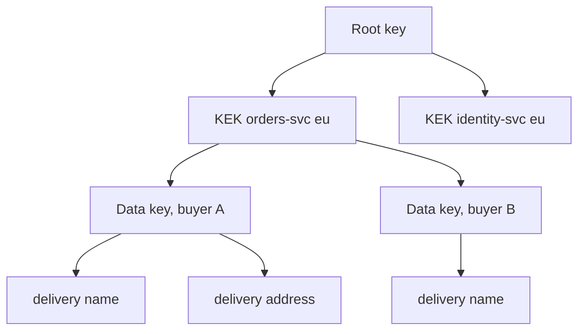

| Status | Stable |
| -- | -- |
| Version | 1.0 |
| Updated | 2026-01-26 |
| Owner | DemoPeggy |
| Applies to | Field-level encryption of personal data ([RFC-029](@RFC-029)) |

## Overview

Personal data fields are encrypted with data keys; data keys are encrypted with key encryption keys held by the cloud key management service; nothing below the key management service ever stores a key in clear.

## Levels

| Level | Key | Where it lives | Rotation | Scope |
| -- | -- | -- | -- | -- |
| 1 | Root key | Key management service, hardware-backed | managed by the provider | the account |
| 2 | Key encryption key | Key management service | yearly | one per service and region |
| 3 | Data key | Stored wrapped, next to the record it protects | never; replaced on re-encryption | one per buyer or seller account |
| 4 | Ciphertext | Database columns, backups, replicas | | one per field value |



## Data key record

```sql
CREATE TABLE data_keys (
    account_id   uuid        PRIMARY KEY,
    kek_id       text        NOT NULL,     -- key management key version
    wrapped_key  bytea       NOT NULL,     -- 256-bit key, wrapped
    created_at   timestamptz NOT NULL DEFAULT now(),
    destroyed_at timestamptz
);
```

## Sealed field format

Each encrypted value is stored as JSON in a `jsonb` column:

```json
{ "v": 1, "k": "dk_0192f1c2", "n": "q1Xg2rB0m8xK0c9P", "c": "J8f0b2...Zx==" }
```

| Field | Meaning |
| -- | -- |
| `v` | Format version |
| `k` | Data key id (the account) |
| `n` | 96-bit nonce, random per value |
| `c` | AES-256-GCM ciphertext with tag; associated data is table and column name |

Associated data stops a ciphertext from being copied into another column and decrypted there.

## Operations

| Operation | Calls to key management | Notes |
| -- | -- | -- |
| Encrypt or decrypt a field | none if the data key is cached | cache 5 minutes per pod |
| First use of an account's key in a pod | 1 unwrap | p99 18 ms ([RN-028](@RN-028)) |
| Rotate a key encryption key | 1 rewrap per data key | background job, 2 hours for all keys |
| Delete an account | none | set `destroyed_at`, delete `wrapped_key` |

## Limits

| Limit | Value |
| -- | -- |
| Unwrap calls per second per service | 1,000 (provider quota 5,000) |
| Plaintext field size | 4 KB |

## Version history

| Version | Date | Change |
| -- | -- | -- |
| 1.0 | 2026-01-26 | First version |

## Related

* [ADR-028 Encrypt personal data at the field level](@ADR-028)
* [ADR-047 Keep secrets in a managed secret store](@ADR-047)
