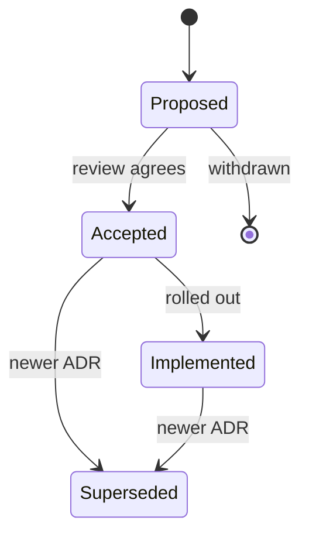

| Status | Accepted |
| -- | -- |
| Date | 2025-01-08 |
| Authors | DemoAlice |
| Reviewers | DemoBob, DemoCarol |

## Context

DemoMart grew from four services to twelve in 2024. Decisions about databases, messaging and APIs were made in calls and chat threads, and six months later nobody could say why `cart-svc` keeps carts in Redis or why the public API has no version prefix. New engineers asked the same questions in their first week, and two decisions were reversed by accident because the reasons were lost.

We want a record that is short to write, easy to find, reviewed like code, and kept next to the code it shapes.

## Decision

We record every architecture decision that is hard to reverse as an **Architecture Decision Record (ADR)**: one Markdown file per decision, numbered in order, in the `decisions` folder of the engineering documents.

* One decision per record. If a record needs "and", it is two records.
* Every record starts with a status table: Status, Date, Authors, Reviewers, and Supersedes or Superseded by where it applies.
* Sections: Context, Decision, Options considered, Consequences, Follow-up. The ADR template in the engineering documents shows them.
* Statuses: Proposed, Accepted, Implemented, Superseded. A record is never deleted or rewritten to say the opposite; a new record supersedes it.
* A decision that needs discussion first starts as an RFC; the ADR records the outcome.

## Options considered

| Option | Findable | Reviewed | Effort per decision | Verdict |
| -- | -- | -- | -- | -- |
| **Markdown ADRs in the documents repository** | **by number and title** | **pull request** | **30 to 60 minutes** | **Chosen** |
| Wiki pages | search only | no | 30 minutes | Pages drift and lose their history |
| Comments in code | only near the code | yes | 10 minutes | Cross-service decisions have no home |
| Nothing written (today) | no | no | none | The problem we have |

## Consequences

* Each decision costs half an hour to an hour of writing. We expect 20 to 30 records a year.
* Reviews happen in pull requests, so a decision gets the same scrutiny as code.
* Onboarding reads the list of ADRs instead of asking in chat.

## Follow-up

- [X] Write the template
- [X] Record the twelve decisions already made in 2024 that still hold (ADR-002 to ADR-013)
- [ ] Link each service's README to the ADRs that shape it
