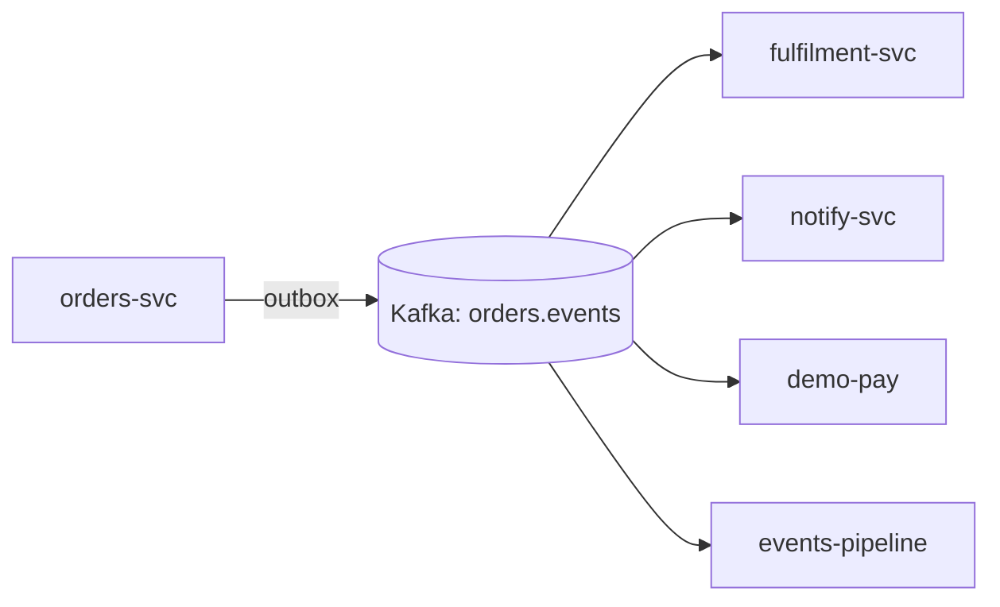

| Status | Accepted |
| -- | -- |
| Date | 2025-02-18 |
| Authors | DemoCarol |
| Reviewers | DemoAlice, DemoDave |
| Evidence | [RN-015 Kafka versus NATS JetStream](@RN-015) |

## Context

Services tell each other about changes through HTTP callbacks today. When `orders-svc` confirms an order, it calls `fulfilment-svc`, `notify-svc` and `demo-pay` one after another; if one of them is down, the order waits, and a retry can deliver the same callback twice. With twelve services and about 40 such callbacks, every new consumer means a change in the producer.

We want producers to publish a fact once ("order 81 was confirmed") and let any number of consumers read it at their own pace, replay it after a bug fix, and keep the order of events per entity.

## Decision

We use **Apache Kafka** as the one log for domain events, on a managed cluster with three brokers per region.

* One topic per aggregate type, keyed by the aggregate id, so all events of one order land in one partition and keep their order ([topic rules](@SPEC-021)).
* Events use the common envelope of [SPEC-016](@SPEC-016); payloads are Protobuf ([ADR-026](@ADR-026)).
* Producers publish through the transactional outbox ([ADR-014](@ADR-014)), never directly from request handlers.
* Topics keep events for 7 days; the analytics copy keeps them longer ([ADR-027](@ADR-027)).

## Options considered

| Option | Ordering per key | Replay | Throughput at p99 under 20 ms | Operations | Verdict |
| -- | -- | -- | -- | -- | -- |
| **Kafka (managed)** | **yes, per partition** | **yes, by offset** | **48,000 events/s** | **managed service** | **Chosen** |
| NATS JetStream | per subject | yes | 31,000 events/s | we run it | Lower throughput with large batches |
| RabbitMQ quorum queues | per queue | no, once consumed | 18,000 events/s | we run it | No replay |
| HTTP callbacks (today) | no | no | not measured | none | The problem we have |

The numbers are from [RN-015](@RN-015), measured with production-sized order events.

## Consequences

* Producers no longer know their consumers; adding one is a change in the consumer only.
* Consumers must be idempotent: Kafka delivers at least once. Each consumer stores the last event id it applied per aggregate.
* The managed cluster costs about 1,900 USD a month per region, replacing no existing cost. We accept it for the decoupling.
* Teams need to learn partitioning and consumer groups; [RFC-028](@RFC-028) adds dead letter topics for failing consumers.

## Follow-up

- [X] Order events on Kafka in production
- [X] Payment events on Kafka in production
- [X] Remove the last HTTP callback from `orders-svc`
- [ ] Product events on Kafka (tracked in [SPEC-018](@SPEC-018))
