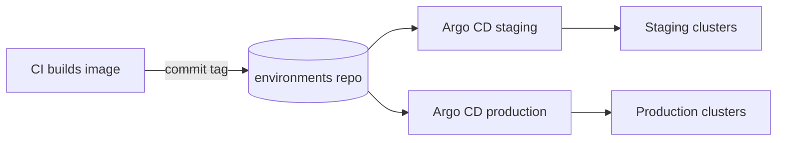

| Status | Implemented |
| -- | -- |
| Date | 2025-03-31 |
| Authors | DemoBob |
| Reviewers | DemoFrank, DemoKen |

## Context

After the move to Kubernetes ([ADR-002](@ADR-002)), services deploy with `kubectl apply` from CI jobs that hold cluster credentials. Nobody can say what runs in production without asking the cluster, a manual hotfix in March was overwritten by the next deploy, and the CI system holds admin credentials for four clusters.

## Decision

Deploys are **GitOps with Argo CD**. One repository, `environments`, holds the desired state of every cluster; Argo CD in each cluster pulls and applies it.

* Folder layout: `clusters/<region>-<env>/<service>/`, with Kustomize overlays over the service's base manifest.
* CI builds the image and opens a commit that changes only the image tag; it holds no cluster credentials.
* Staging syncs automatically; production syncs automatically too, behind the canary stage of [SPEC-003](@SPEC-003).
* Manual changes in a cluster are reverted within 3 minutes (self-heal on).

## Options considered

| Option | Credentials in CI | Drift detection | Rollback | Verdict |
| -- | -- | -- | -- | -- |
| **Argo CD, one environments repository** | **none** | **continuous** | **git revert, about 2 min** | **Chosen** |
| Flux | none | continuous | git revert | Equal; the team knows Argo CD's interface |
| `kubectl apply` from CI (today) | admin on four clusters | none | redeploy, about 9 min | The problem we have |
| One repository per service | none | continuous | git revert | Cross-service changes need many commits |

## Consequences

* The state of every environment is readable in one place, with history.
* A deploy is a commit; the audit trail comes for free.
* The `environments` repository becomes critical: branch protection and two reviewers for production folders.

## Follow-up

- [X] Argo CD in all four clusters
- [X] Move all twelve services
- [X] Remove cluster credentials from CI
