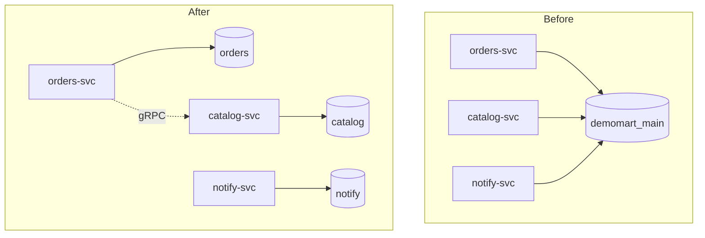

| Status | Accepted |
| -- | -- |
| Date | 2025-07-03 |
| Authors | DemoCarol |
| Reviewers | DemoAlice, DemoIvan |
| Plan | [RFC-016 Splitting the shared database by service](@RFC-016) |

## Context

Seven services share one PostgreSQL database, `demomart_main`, with 214 tables. `orders-svc` reads `catalog` tables directly, `notify-svc` writes to `orders`, and a migration in one service locked a table another service needed for 6 minutes in June. Nobody can change a table without asking four teams.

## Decision

Every service owns **its own database**, and no service reads or writes another service's tables.

* A service exposes its data through its gRPC API ([ADR-006](@ADR-006)) or its events ([ADR-005](@ADR-005)).
* Databases may share an instance for cost, but each has its own schema owner and credentials; credentials for another service's database are never issued.
* Reports that join across services read the analytics copy in ClickHouse ([ADR-011](@ADR-011)), not the service databases.
* The split happens table by table, as planned in [RFC-016](@RFC-016).

## Options considered

| Option | Cross-team migrations per quarter | Joins across domains | Effort | Verdict |
| -- | -- | -- | -- | -- |
| **Database per service** | **0 expected** | **through APIs or analytics** | **about 3 quarters** | **Chosen** |
| Schema per service, one database | 0 | possible, but forbidden by rule | 1 quarter | The rule would erode; one failure domain |
| Shared database (today) | 11 in Q2 2025 | direct SQL | none | The problem we have |

## Consequences

* Some queries become API calls; `orders-svc` gets a price cache to avoid 40 calls per order page.
* Foreign keys across services disappear; consistency is kept by events and reconciliation ([ADR-049](@ADR-049)).
* Each team can migrate its schema on its own schedule.

## Follow-up

- [X] Catalog tables moved out
- [X] Orders tables moved out
- [ ] Notify and identity tables moved out
- [ ] `demomart_main` read-only, then archived
