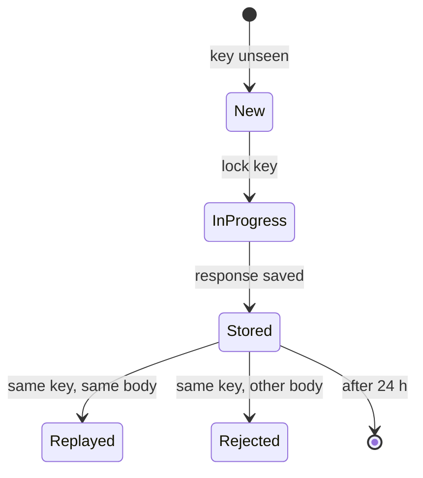

| Status | Accepted |
| -- | -- |
| Date | 2025-08-26 |
| Authors | DemoJudy |
| Reviewers | DemoHeidi, DemoMike |
| Evidence | [RN-037 Duplicate requests without idempotency keys](@RN-037) |

## Context

Partners retry requests that time out. When the first request succeeded but the response was lost, the retry creates a second shipment, a second refund or a second listing. [RN-037](@RN-037) found 0.21 % of `POST` requests in August were duplicates, about 3,400 a day; 41 of them were duplicate refunds.

## Decision

Every `POST` and `PATCH` in `/v2` requires an `Idempotency-Key` header; `DELETE` and `PUT` accept one.

* The key is any string up to 255 characters, unique per partner application; a UUIDv4 is recommended.
* `api-gateway` stores the key, a hash of the request body and the response for 24 hours.
* A retry with the same key and body returns the stored response with `Idempotent-Replayed: true`.
* The same key with a different body returns `422` with problem type `idempotency-key-reused`.
* A request still in progress returns `409`. Details in [SPEC-035](@SPEC-035); proposal in [RFC-034](@RFC-034).

## Options considered

| Option | Duplicates prevented | Partner effort | Storage | Verdict |
| -- | -- | -- | -- | -- |
| **Required idempotency keys** | **all retried writes** | **one header** | **about 9 GB in Redis** | **Chosen** |
| Optional idempotency keys | only careful partners | none | less | Most duplicates come from partners who would not opt in |
| Deduplicate on body hash only | most | none | similar | Two genuine identical orders would collide |
| Nothing (today) | none | none | none | The problem we have |

## Consequences

* Retries become safe; SDKs set the header automatically.
* `v1` stays without the requirement until it is retired.

## Follow-up

- [X] Key store in `api-gateway`
- [X] SDKs generate keys
- [ ] Measure duplicates again after three months
